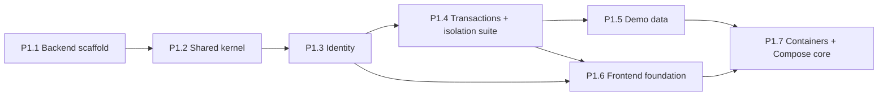
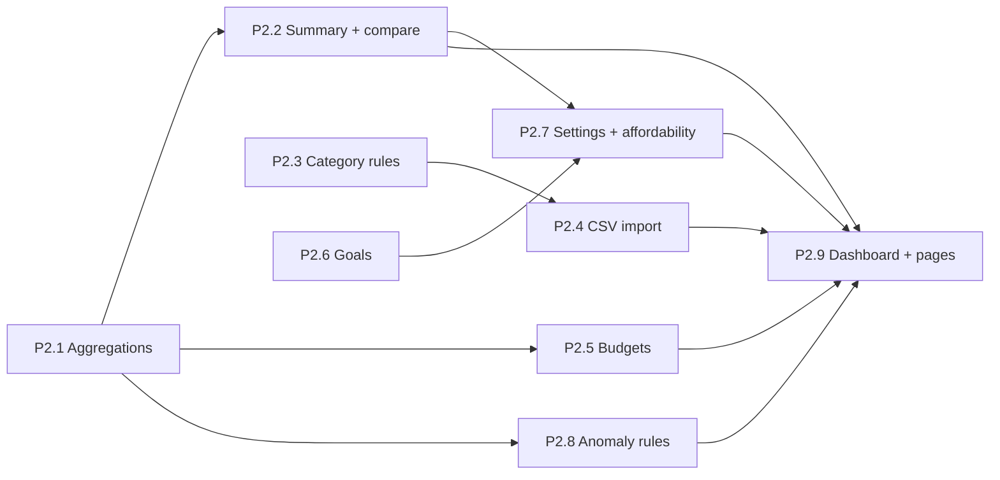

# MonthEndBuddy — Implementation Plan

> Companion to `MonthEndBuddy_Project_Specification.md` (what to build), [architecture.md](architecture.md) (how) and [low-level-design.md](low-level-design.md) (classes). This document sets the **order of work**. It breaks the build into work items small enough for one PR each, and says what each one delivers, how it is tested and when it is done. It points to the designs rather than repeating them.

| | |
|---|---|
| **Status** | Draft v1. Nothing is implemented yet. |
| **Covers** | Phase 0 (setup) through Phase 6 (portfolio readiness) |
| **Reference notation** | `S§` = spec, `A§` = architecture.md, `L§` = low-level-design.md |
| **Last updated** | 2026-10-26 |

---

## Contents

1. [How to use this plan](#1-how-to-use-this-plan)
2. [Plan-level decisions](#2-plan-level-decisions)
3. [Repository layout and migrations](#3-repository-layout-and-migrations)
4. [Phase 0 — Setup and de-risking](#4-phase-0--setup-and-de-risking)
5. [Phase 1 — Foundation](#5-phase-1--foundation)
6. [Phase 2 — Finance features](#6-phase-2--finance-features)
7. [Phase 3 — AI agent](#7-phase-3--ai-agent)
8. [Phase 4 — UI polish and streaming](#8-phase-4--ui-polish-and-streaming)
9. [Phase 5 — Redis and Kafka](#9-phase-5--redis-and-kafka)
10. [Phase 6 — Portfolio readiness](#10-phase-6--portfolio-readiness)
11. [Traceability to the first-demo checklist](#11-traceability-to-the-first-demo-checklist)
12. [Schedule risks](#12-schedule-risks)

---

## 1. How to use this plan

### 1.1 Rules

- **Work items** have IDs such as `P2.4`. Each one is meant to be a single branch and PR; split it if it grows.
- **Sizes are relative and rough:** **S** is under a day, **M** is 1–3 days and **L** is 3–5 days for one developer. They are for planning, not commitments.
- **Order.** Phases run in sequence, and a phase starts only once the previous phase's exit check passes. Within a phase, follow the dependency diagram. The Phase 0 provider spike is deliberately early.
- **Before starting a work item, read the design sections it cites.** Where an item says "decide", make the decision in that PR and update the design doc in the same PR.
- **Every work item that adds an endpoint or an agent tool also adds a row to the user-isolation suite** (built in P1.4). That keeps S§16's "another user's data cannot be accessed" true as the app grows, instead of leaving it to Phase 6.

**Standing checks for every PR**, once they exist:
- CI passes.
- `ApplicationModules.verify()` passes.
- Schema changes are new Flyway files; an applied file is never edited.
- If the REST contract changed, the generated frontend API types are regenerated in the same PR.

### 1.2 Roadmap at a glance

| Phase | Work items | Exit check | Compose profile |
|---|---|---|---|
| 0 Setup | P0.1–P0.3 | Name settled, repo and CI exist, provider spike written up | — |
| 1 Foundation | P1.1–P1.7 | A user can log in (or use the demo) and manage transactions from `docker compose up` | `core` |
| 2 Finance | P2.1–P2.9 | Every displayed figure comes from a tested backend calculation | `core` |
| 3 Agent | P3.1–P3.6 | The agent answers finance questions through tools and passes the eval gate | `core` |
| 4 UI polish | P4.1–P4.5 | Streaming copilot; polished, accessible desktop and mobile UI | `core` |
| 5 Redis/Kafka | P5.1–P5.5 | Async processing survives retries and duplicate delivery | `full` |
| 6 Portfolio | P6.1–P6.5 | A reviewer can clone the repo and run the demo from the README | `core` / `full` |

---

## 2. Plan-level decisions

### 2.1 Choices the design leaves open

| # | Decision | Choice | Why |
|---|---|---|---|
| I1 | Build tool | **Maven** with the Maven Wrapper (`./mvnw`). The parent is `spring-boot-starter-parent`, and the Spring AI, Spring Modulith and Testcontainers BOMs are imported in `dependencyManagement`. Every other version is a `<properties>` entry. Surefire runs unit tests (`*Test`) and Failsafe runs integration tests (`*IT`), both through `./mvnw verify`. | Owner's decision (2026-10-26). A§15 and A§17.3 were updated to Maven equivalents. |
| I2 | Version-pinning order | Pick the Spring AI GA release first (P0.3), then the Spring Boot line it supports. Use Java 21 and the current Node LTS. | Spring AI is the most version-sensitive dependency (A§19) |
| I3 | Module boundary checks | Spring Modulith `ApplicationModules.verify()`, with `common` declared as a shared module | Its named interfaces match the `package-info.java` surface in A§4.2. ArchUnit is the fallback. |
| I4 | Where a module's cross-module API lives | In the module's **root package** (for example `dev.monthendbuddy.transactions.TransactionAggregations`), plus an `events` subpackage exposed as a named interface. `api/` holds only REST controllers and DTOs, and implementations live in `application/` or `infrastructure/`. | In A§4.2, `api/` means REST, and Modulith exposes a module's root package by default; keeping them apart stops controllers leaking as module API. This also settles where events go: L§2 says `transactions.events`, while L§12.4 puts them under `domain/`. Use `transactions.events` and update L§12.4. |
| I5 | JWT library | Nimbus JOSE (`spring-security-oauth2-jose`) behind `JwtService` | Already part of Spring Security, so no extra JWT dependency |
| I6 | Password encoder | Build a `DelegatingPasswordEncoder` by hand with `argon2` as the default id, and add BouncyCastle to the classpath | `PasswordEncoderFactories` defaults to bcrypt, and `Argon2PasswordEncoder` needs BouncyCastle (A§5.1) |
| I7 | CSV parser | Apache Commons CSV | A§8.2 allows it or Jackson CSV; it streams and handles quoted commas |
| I8 | Rate limiting | Bucket4j: in-memory from P1.3, Redis-backed from P5.3 | A§11.2 |
| I9 | Frontend tooling | npm, ESLint, Prettier, Vitest and Testing Library; API types from `openapi-typescript` | A§13.1, A§15, A§17.4 |
| I10 | Repository | A single GitHub monorepo; CI jobs filtered by path (`backend/**`, `frontend/**`) | S§14 |
| I11 | Profile flags in Compose | Compose profiles only switch services on and off; they cannot change the backend's environment. Put the `meb.*` flags in committed `infra/env/core.env` and `infra/env/full.env` files, which contain no secrets, and select one with `--env-file` or an override file. | A§3 ties the flags to profiles, but Compose does not do that by itself |

### 2.2 Changes to the design and roadmap

| # | Change | Reason |
|---|---|---|
| C1 | `GET /alerts` and `PATCH /alerts/{id}` ship in P2.8 instead of Phase 5 (A§13.2). | The anomaly rules already run in-process from Phase 2 (A§18). The dashboard insights panel (S§4.3) and the `findUnusualTransactions` tool (P3.4) need them, and S§4.7 requires users to be able to dismiss an alert or mark it expected. |
| C2 | A throwaway provider spike in Phase 0 (P0.3). | It moves the largest unknown (A§19) ahead of any agent code that would be designed around it. |
| C3 | gitleaks runs in CI from the first commit, not from P6 (A§18). | It costs nothing, and the risk of committing a secret is highest while the repo is being set up. |
| C4 | The grounding check moves from a P6.2 stretch goal to a P3.4 requirement. Tools clamp out-of-range limits instead of returning an error. `max-tool-iterations` goes from 5 to 6. | The P0.3 spike (ADR 0001) saw `gpt-oss-120b` invent a 50-row table after a tool error in 1 of 3 runs, and it makes only one tool call per iteration. |

---

## 3. Repository layout and migrations

### 3.1 Layout

This follows S§14, with the paths the design adds:

```text
monthendbuddy/
├── backend/
│   ├── pom.xml · mvnw · .mvn/wrapper/
│   └── src/
│       ├── main/java/dev/monthendbuddy/{common,identity,transactions,budgets,goals,analytics,agent,notifications}/
│       ├── main/resources/  application.yml · application-local.yml · db/migration/ · agent/prompts/system-v1.md
│       └── test/            …  · test/resources/eval/
├── frontend/                src/{app,lib,components,features,pages,visuals}   (A§14)
├── infra/                   docker-compose.yml · env/{core,full}.env · nginx/default.conf · observability/
├── docs/                    + api.md · ai-evaluation.md · adr/
├── sample-data/             synthetic-transactions.csv   (generated in P1.5)
├── .github/                 workflows/{secrets-scan,backend,frontend,e2e}.yml · dependabot.yml
└── .env.example · .gitignore · README.md · CLAUDE.md
```

### 3.2 Flyway migration sequence

PostgreSQL must be version 16 or later, because the budgets index uses `NULLS NOT DISTINCT` (A§7.2).

| File | Work item | Contents |
|---|---|---|
| `V1__identity.sql` | P1.3 | `citext` extension; `users`, `user_settings`, `refresh_tokens` |
| `V2__transactions.sql` | P1.4 | `pg_trgm` extension; `categories` with the system seed; `transactions` with every A§7.2 index, including the partial unique fingerprint index |
| `V3__category_rules.sql` | P2.3 | `category_rules` |
| `V4__imports.sql` | P2.4 | `import_jobs`, `import_rows` |
| `V5__processed_events.sql` | P2.5 | `processed_events`, which arrives with the first idempotent handler |
| `V6__budgets.sql` | P2.5 | `budgets` (partial unique index with `NULLS NOT DISTINCT`), `budget_threshold_events` |
| `V7__goals.sql` | P2.6 | `savings_goals` |
| `V8__anomaly_alerts.sql` | P2.8 | `anomaly_alerts` |
| `V9__agent.sql` | P3.1 | `agent_conversations`, `agent_messages` |
| `V10__outbox.sql` | P5.4 | `outbox_events` |
| `V11__notifications.sql` | P5.5 | `notifications` |

If PRs merge in a different order, renumber the files before merging. By default Flyway refuses to apply a version lower than one already applied.

---

## 4. Phase 0 — Setup and de-risking

**Goal:** settle the open decisions and prove the riskiest integration before any product code exists.

### P0.1 Confirm the product name · S · ✅ done 2026-10-26

- The product is **MonthEndBuddy** (A§19). The spec was renamed from `FinPilot_AI_Project_Specification.md` to `MonthEndBuddy_Project_Specification.md`, and the references in `architecture.md`, this plan and `CLAUDE.md` were updated.
- **Done when** a single product name is used everywhere.

### P0.2 Repository bootstrap · S · ✅ done 2026-10-26 (first commit `659fb5f`; secrets-scan green)

- Run `git init`, create the GitHub repository and protect `main`.
- Add `.gitignore` covering `.env`, `build/`, `node_modules/`, `.DS_Store` and IDE files, and delete the existing `.DS_Store`.
- Add `.env.example` with every variable from S§15 and A§18 as a placeholder.
- Add a README stub, `dependabot.yml`, and a CI workflow that runs gitleaks (C3).
- **Done when** the first commit on `main` contains no secrets and CI runs on it.

### P0.3 Provider spike (throwaway branch) · M · ✅ done 2026-10-26 ([ADR 0001](adr/0001-llm-provider-and-spring-ai-version.md))

The spike needs a Groq account and API key.

- Build a minimal Spring Boot app that uses the Spring AI OpenAI starter, pointed at Groq's OpenAI-compatible base URL (A§10.2).
- Give it one tool with a record input. Turn Spring AI's internal tool execution off and run the tool loop in application code (A§10.3).
- Find out:
  - the working property names;
  - how to disable internal execution and read the returned tool calls;
  - whether `openai/gpt-oss-120b` makes parallel and sequential tool calls, follows the JSON schema, and recovers after a structured error result;
  - Groq's published free-tier limits today;
  - one fallback model;
  - whether the starter boots with an empty API key (it matters for P3.1).
- Write the findings to `docs/adr/0001-llm-provider-and-spring-ai-version.md`, including the pinned Spring AI version. The spike code is not merged.
- **Done when** the ADR is merged and the I2 version pins are chosen. If tool calling is unreliable, choose the fallback model now. The orchestrator is provider-agnostic, so nothing else in the plan changes.

**Phase 0 exit:** P0.1–P0.3 are done.

---

## 5. Phase 1 — Foundation

**Exit (S§13):** a user can log in and manage synthetic transactions.



### P1.1 Backend scaffold · M · ✅ done 2026-10-26

- Create the Maven project with its wrapper and version properties (I1, I2), with `<release>21</release>` so that it builds on a newer local JDK. Add the `dev.monthendbuddy` application class, and one package per module with a `package-info.java`.
- Profiles are `local` and `test`. The API runs on port 8081. Actuator runs on management port 8082, with liveness and readiness groups.
- Add Flyway and the PostgreSQL driver, and configure JPA:
  - `ddl-auto=validate`;
  - `spring.jpa.open-in-view=false`, because Spring Boot turns it on by default and the services own their transaction boundaries.
- Turn on structured JSON logging. Enable Springdoc in the `local` profile only.
- Test infrastructure:
  - an abstract integration-test base using Testcontainers PostgreSQL 16 or later, with container reuse;
  - a Spring Modulith `verify()` test (I3).
- Create `infra/docker-compose.yml` with only postgres, so that `./mvnw spring-boot:run` has a database.
- CI (`backend.yml`) runs the build with unit and integration tests. **Record the actual commands in `CLAUDE.md`.**
- **Done when** `./mvnw verify` passes in CI, the app boots locally against the Compose database, and `/actuator/health/readiness` on port 8082 reports UP.

### P1.2 Shared kernel · M — L§2, A§6.1, A§13.1 · ✅ done 2026-10-26

- Value objects: `Money`, `CurrencyCode`, `Period`, `UserId`. *As built:* `Money` has no JPA mapping yet. It is mapped per entity when the first money column lands (P1.3/P1.4), because `user_settings` stores amounts without a currency column.
- *As built:* `common` is an **open** Modulith module, so its sub-packages (`error`, `web`, `persistence`, `events`, `json`, `time`) are visible to every module. `spring.web.resources.add-mappings=false` makes unknown paths raise `NoHandlerFoundException`, so they get the full problem body; with static mappings on, they bypassed `@RestControllerAdvice`.
- Base classes `BaseEntity` and `UserOwnedEntity`.
- `UserOwnedRepository<T>`: an `@NoRepositoryBean` interface that extends Spring Data's `Repository<T, UUID>`, not `JpaRepository`. It declares only scoped methods and `save`, so `findById` and `findAll` never exist (A§5.3).
- Jackson configuration so that money always goes out as `{"amount": "<string>", "currency": …}` and never as a JSON number.
- The L§12.2 exception hierarchy and a `GlobalExceptionHandler` that returns `ProblemDetail` with `code`, `traceId` and `errors[]`. Spring maps Bean Validation failures to **400** by default; the design requires **422**, so map them explicitly.
- A correlation filter that puts the `traceId` into the MDC, and an injectable `Clock` bean.
- The `DomainEvent`, `EventPublisher` and `InProcessEventPublisher` types.
- **Tests:**
  - `Money`: `HALF_EVEN` rounding, scale-2 output, currency mismatch throws.
  - `Period`: February and leap years, the 24-month limit, a future period returns 422.
  - The `ProblemDetail` shape for 404 and 422.

### P1.3 Identity and authentication · L — A§5, L§3 · ✅ done 2026-10-26

- Migration `V1`.
- Entities `User`, `UserSettings` (defaults created at registration) and `RefreshToken`.
- `AuthService` (register, login, refresh, logout) and `JwtService` (I5):
  - HS256 with 15-minute tokens;
  - `JWT_SECRET` must be at least 32 bytes, and the app refuses to start otherwise.
- `RefreshTokenService` with rotation and reuse detection (L§3 rotation steps).
- Password encoder (I6) and password policy: at least 10 characters, checked against a common-password list.
- `SecurityConfig`: stateless, with a Bearer filter and `CurrentUserArgumentResolver`. Only the register, login, refresh, logout and demo endpoints are public.
- Refresh cookie:
  - attributes `httpOnly; Secure; SameSite=Strict; Path=/api/v1/auth`;
  - the refresh and logout endpoints check `Origin` against `APP_BASE_URL` and require the `X-MEB-Client: web` header.
- `GET /me` and `GET /me/settings`.
- In-memory Bucket4j limits for the `LOGIN` and `REGISTER` buckets, returning 429 with `Retry-After`.
- **Tests:**
  - Register → login → protected call → token expires (fixed `Clock`) → 401 `token_expired` → refresh → retry succeeds.
  - Reusing a rotated refresh token revokes the whole family.
  - An unknown email and a wrong password return byte-identical 401 bodies.
  - The login limit returns 429.
  - Unit tests for `RefreshToken` state changes.
- **Done when** no endpoint outside the public list responds without a token.
- *As built:*
  - **Login failures:** the two 401 bodies are identical apart from `traceId`. The unknown-email path also runs a dummy Argon2 check, so timing does not reveal registered emails.
  - **Refresh reuse:** reuse detection commits the family revocation even though the call fails (`noRollbackFor`), and token rows are locked with `SELECT … FOR UPDATE`.
  - **Proxy headers:** `server.forward-headers-strategy=native` lets rate limits see the client IP behind nginx.
  - **Local development:** the `local` profile has a development-only JWT secret, and allows the Vite origin `http://localhost:5173` on the refresh and logout endpoints.
  - **Test support:** integration tests use the `test` profile, `support/MutableClock` (reset after each test) and `support/ApiClient`.

### P1.4 Categories, transactions and the isolation suite · L — A§8.1, L§4.1 · ✅ done 2026-10-26

- Migration `V2`.
- `Category` (system categories plus custom ones) and `CategoryService` with `listUsable` and `requireUsable`.
- `/categories` endpoints; deleting a category archives it.
- `Transaction`, `TransactionService` and `TransactionController` for `/transactions` CRUD:
  - `TransactionFilter`, and keyset pagination with an opaque cursor over `(transaction_date DESC, id DESC)`;
  - text search using the trigram index;
  - a stale `version` returns 409;
  - another user's category, or a category that doesn't exist, returns 422;
  - a non-INR currency returns 422 `unsupported_currency`;
  - amounts use `@PositiveMoney`.
- `TransactionQueries` lives in the module root (I4). The `TransactionCreated`, `TransactionUpdated` and `TransactionDeleted` events live in `transactions.events` and have no listeners yet.
- **The user-isolation suite.** This is a parameterised integration test:
  - It seeds users A and B, then calls every resource endpoint as B with A's IDs, expecting 404 or an empty result.
  - Cases are rows in a table, so each later work item adds rows.
  - A **coverage guard** lists every handler method with a path variable (from `RequestMappingHandlerMapping`) and fails if any is missing from the suite.
- **Tests:** CRUD; pagination that stays stable across pages with many rows on the same date; version conflicts; filter combinations.
- **Done when** the isolation suite and its coverage guard both pass.
- *As built:*
  - **Isolation suite:** `UserIsolationIT.cases()` is the table. Its guard was checked by deleting a row, which made it fail. The 404 for another user's ID is byte-identical to the 404 for a missing ID, apart from `traceId` and `instance`.
  - **Query layer:** list and search run as native SQL in `TransactionQueryRepository`. It uses the indexed `lower(description || ' ' || coalesce(merchant, ''))` expression and a row-value keyset `(transaction_date, id) < (…)`.
  - **Currency on the wire:** `MoneyDto.currency` is a string, so `USD` gives 422 `unsupported_currency`, not a JSON parse error.
  - **Category rules:**
    - A category's kind must match the transaction type.
    - On update, an unchanged category is accepted even if archived, and keeps its `categorySource`.
    - System categories have fixed IDs `0192f000-0000-7000-8000-…` and return 403 `category_read_only` on PATCH and DELETE.
    - An archived category's name stays reserved.
  - **Events:** IDs are UUIDv7. The `type` field is a string, so consumers need only the `events` package.

### P1.5 Demo user and synthetic data · M — A§5.2, S§4.1 · ✅ done 2026-10-26

- A `SyntheticDataGenerator` that takes a seed, an **anchor date** and the number of users:
  - It produces about 6 months of INR data: a monthly salary, realistic categories, and a few **deliberately planted anomalies** for P2.8.
  - The demo anchors on today, so "this month" always has data. The eval fixtures (P3.6) use a fixed anchor and a fixed `Clock`.
- `POST /auth/demo`, the `users.is_demo` flag, and `DemoDataService.resetDemoUser()` scheduled nightly.
- A Maven profile (`-Psample-data`, using `exec-maven-plugin`) that exports `sample-data/synthetic-transactions.csv` in the A§8.2 format.
- **Done when** demo login returns about 6 months of data and the same seed and anchor produce byte-identical output.
- *As built:*
  - **New module:** a **`demo` module** (allowed dependencies: identity and transactions; nothing depends on it). It owns `SyntheticDataGenerator`, `SampleCsv`, `SampleDataExporter` and `DemoDataService`. Identity exposes `DemoAccounts`, and transactions exposes `TransactionSeeder` (a bulk replace in one transaction, with no per-row events).
  - **Generated data:** 214 rows for the committed sample (seed 20261026, anchor 2026-10-15).
  - **Planted anomalies:**
    - insurance ₹12,450 in month 1;
    - laptop ₹62,000 two months back;
    - dining ₹8,400 last month;
    - Goa trip ₹18,000 this month.
  - **Drift check:** `SyntheticDataGeneratorTest` fails if the committed CSV drifts from the generator.
  - **Demo login and reset:**
    - `POST /auth/demo` is limited per IP by the `DEMO_LOGIN` bucket (30/hour).
    - The demo email is reserved, so registering it returns 409.
    - The reset refuses to touch a non-demo account.
    - It resets at every startup (changed in P2.9, so a deploy always gets fresh, fully processed demo data) and nightly at 03:00 IST.

### P1.6 Frontend foundation · L — A§14, S§5 · ✅ done 2026-10-26

- Set up Vite, React, TypeScript, Tailwind, React Router, TanStack Query, React Hook Form with Zod, and the I9 tooling.
- `lib/apiClient`:
  - the access token is kept in memory;
  - on a 401, it makes one refresh call and queues concurrent requests behind it;
  - it attempts a silent refresh when the app loads;
  - it sends the `X-MEB-Client` header.
- `lib/money.ts` only formats money. Pass the decimal **string** directly to `Intl.NumberFormat('en-IN', …).format()`, which accepts strings in current browsers, so the value is never converted to a float.
- `lib/dates.ts`, and `npm run gen:api`, which generates types from `/v3/api-docs`.
- The Vite dev proxy sends `/api` to `localhost:8081`.
- Pages:
  - login, register and a demo button labelled as demo data;
  - transactions, with filters, cursor-based "load more", and create, edit and delete forms (edit sends `version`);
  - a table that becomes cards on narrow screens;
  - a basic layout shell (left nav and top bar). The full design system comes in P4.2.
- **Tests:**
  - Three concurrent 401s trigger exactly one refresh.
  - Money formatting gives `₹1,00,000.00` and handles negative values.
  - Form validation.
- CI: `frontend.yml` runs lint, test and build.
- *As built:*
  - **Version pins:** React 19.3, React Router 8.5 (data router; `RouterProvider` from `react-router/dom`; routes lazy-load), Vite 8, Vitest 5, Tailwind 4 and TanStack Query 5.
  - **Pinned below latest:**
    - TypeScript stays on **5.9.3**, because `typescript-eslint` needs <6.1 and `openapi-typescript` needs 5.x.
    - `@hookform/resolvers` stays on **5.9.2**, because 6.0.0's optional peer dependencies conflict.
  - **API types:** `src/lib/api/types.ts` narrows the generated types. Springdoc marks every response property optional, and `Money` is now documented as `MoneyDto` (backend `OpenApiConfiguration`).
  - **Dialog state:** dialogs remount their form via `key` rather than resetting state in effects (React Hooks v7 lint).
  - **Proxy check:** login, refresh with the Vite origin, and paging were verified through the dev proxy against the real backend.

### P1.7 Containers and Compose `core` · M — A§3 · ✅ done 2026-10-26 (Phase 1 exit check passed)

- Dockerfiles:
  - backend: multi-stage, Temurin 21 JRE, non-root user;
  - frontend: a build stage, then `nginx:alpine`.
- `infra/nginx/default.conf`: SPA fallback, `/api` proxied to `backend:8081`, and the CSP `default-src 'self'`. Actuator is not proxied.
- Compose runs postgres (with a healthcheck and a volume), the backend and the frontend, using `depends_on: condition: service_healthy`. Flags come from `infra/env/core.env` (I11) and secrets from the root `.env`.
- The README gets setup steps, demo credentials and the environment variables.
- **Phase 1 exit check:** on a clean checkout:
  1. Copy `.env.example` to `.env` and set `JWT_SECRET`.
  2. Run `docker compose up`.
  3. Open `http://localhost:8080` and use demo login.
  4. Create, edit and delete transactions.

  CI must also be passing, including the isolation suite.
- *As built:*
  - **Compose file location:** the file is the root `compose.yaml`, not `infra/docker-compose.yml`, because Compose reads `.env` only from the compose file's own directory.
  - **nginx config:** it is baked into the frontend image through `additional_contexts: infra`, because Docker Desktop for macOS may refuse bind mounts from `~/Desktop`.
  - **Images:** nginx is `nginx-unprivileged`, and both containers run as non-root users. A placeholder `JWT_SECRET` in `.env.example` is too short on purpose, so the app refuses to start with it.
  - **Exit check run:**
    - SPA and deep links;
    - CSP and other security headers;
    - `/actuator` not proxied;
    - demo login → refresh → create → update → delete through nginx;
    - JSON logs.

---

## 6. Phase 2 — Finance features

**Exit (S§13):** all displayed financial figures come from tested backend calculations.

**Backend as built (P2.1–P2.8, 2026-10-26)**, 226 tests passing:

- **Where the public API lives:** each module's root package holds the types and services other modules and the agent use.
  - `SummaryService`, `ComparisonService`, `AffordabilityService` and `AnomalyService` are in `analytics`.
  - `BudgetStatusService` is in `budgets`.
  - `SavingsProjectionService` is in `goals`.
  - `TransactionAggregations`, `TransactionQueries` and `CategoryQueries` are in `transactions`.
  - `Assumption` and `AssumptionLabel` moved to `common`, because goals needs them and goals cannot depend on analytics.
- **Cache and demo reset:**
  - The cache seams `UserScopedCache` and `CacheGenerationService` are no-ops. Every write service already calls `bumpAfterCommit`.
  - `DemoDataReset` (in `common`) lets budgets, goals and analytics clear demo data before the reseed. The reseed publishes one `TransactionsImported` event, so the demo account gets budgets checks and anomaly alerts.
- **CSV import:**
  - `errors` and `warnings` are `text` columns holding JSON, not `jsonb`; they are never queried.
  - The 7-day purge also expires idle uploads that were never committed.
  - Atomicity is proven by `ImportFailureIT`: a failure injected after 600 flushed rows leaves nothing behind.
  - `server.tomcat.max-swallow-size` is raised so oversized uploads receive the 413 problem instead of a dropped connection.
- **Event handlers:** both run with `@TransactionalEventListener` plus `REQUIRES_NEW` and extend `IdempotentHandler`. A failing handler does not fail the user's write (`AnomalyHandlerFailureIT`).
- **P2.7 decision:** `AffordabilityResult.dataQuality` (`MISSING_INPUT`, `LOW_DATA`, `DEADLINE_PASSED`) is kept separate from the assumption labels.
- **P2.8 refinements, found by probing the sample data** (architecture §9.5 updated):
  - Routine payments (the same merchant paid at least half the amount within the window) raise no transaction alerts.
  - `LARGE_VS_CATEGORY` replaces `ABSOLUTE_THRESHOLD` for the same transaction.
  - Expenses older than 12 months are not evaluated.
  - Together these cut the sample statement from 21 alerts to 6: the planted ones, plus the first rent payment, which has no history yet.



P2.3 and P2.4 (import) can proceed in parallel with P2.1 and P2.2, as can P2.6.

### P2.1 Aggregation queries · M — A§9.1, L§4.1 · ✅ done 2026-10-26

- The `TransactionAggregations` interface sits in the module root. `TransactionAggregationRepository` implements it in native SQL: `totalsByType`, `totalsByCategory`, `monthlyTotals`, `categoryAmounts` and `coverage`. It is the only class that issues aggregate SQL.
- `transaction_date` is a `DATE`, so the SQL does no timezone conversion. The user's timezone only decides which month is "this month".
- **Tests (Testcontainers, fixtures):** month boundaries; an empty period (`0.00` with count 0); uncategorised rows; another user's rows excluded.
- **Done when** every sum equals the hand-computed fixture total.

### P2.2 Summary, trends and comparison · M — A§6.3, L§7.1 · ✅ done 2026-10-26

- `CashFlowMath`, `SummaryService`, `ComparisonService`, and `AnalyticsController` for `/analytics/summary`, `categories`, `trends` and `compare`.
- Add the cache interfaces now: `UserScopedCache` with `NoOpUserScopedCache`, and `CacheGenerationService` with a no-op implementation.
- Call `bumpAfterCommit` from every write service as it is built, starting with transactions. P5.2 then only swaps the implementation.
- **Tests:**
  - Unit tests for every A§6.3 formula used here: income 0 gives savings rate `null` with `NO_INCOME`; a negative net; previous 0 gives Δ% `null` with `isNew`.
  - Responses match the fixture values exactly, as strings.

### P2.3 Category rules · S — A§8.1 · ✅ done 2026-10-26

- Migration `V3`.
- `CategoryRule`, `Categorizer` (priority order; `CONTAINS`, `STARTS_WITH` and `EQUALS` only, with no regex) and `/category-rules` CRUD.
- Rules apply only when no category is given. A user's edit sets `USER`, and a `USER` category is never overwritten.
- Add isolation rows.

### P2.4 CSV import · L — A§8.2–8.4, L§4.2 · ✅ done 2026-10-26

- Migration `V4`.
- Parsing and validation:
  - the parser (I7) enforces 5 MB, 10,000 rows and UTF-8 with a BOM tolerated;
  - the parser also validates the header and strips control characters;
  - `RowValidator` checks each row;
  - `FingerprintService` normalises, hashes with SHA-256, assigns per-file sequence numbers, and looks up existing fingerprints in batches.
- `ImportJob` state machine with `ImportRow` staging.
- `ImportService` commit:
  - It inserts in batches of 500. Set `hibernate.jdbc.batch_size`; application-generated UUID ids allow batching, while `IDENTITY` ids would not.
  - Forced duplicates are stored with `fingerprint = NULL`.
  - Committing again returns the original result.
- **`markFailed` must be called from the controller** (L§4.2). A call from inside `ImportService` would bypass the Spring proxy, so `REQUIRES_NEW` would silently join the transaction that is rolling back.
- Unknown category names become uncategorised with a warning; rows without a category then go through `Categorizer`.
- `/imports` endpoints, the `CSV_IMPORT` rate limit, MIME and extension checks, the 7-day `import_rows` purge job, and the `TransactionsImported` event.
- **Tests:**
  - Every scenario row in A§8.3 as an integration test.
  - Header errors, and row errors reported with a row number and field.
  - A failure during commit writes zero rows and marks the job `FAILED`, and a retry commits.
  - Re-commit returns the same result.
  - A file with 10,001 rows is rejected.
- **Done when** importing `sample-data/synthetic-transactions.csv` twice imports it once and reports every row as a duplicate the second time.

### P2.5 Budgets and threshold events · M — A§9.2, L§5 · ✅ done 2026-10-26

- Migrations `V5` and `V6`.
- `Budget`, `BudgetMath`, `BudgetService` CRUD, and `BudgetStatusService`, which returns the top 5 transactions through `TransactionQueries.topExpenses`.
- `/budgets` and `/budgets/status`.
- `IdempotentHandler` arrives here with its first subclass, `BudgetThresholdHandler`, which runs in-process on `AFTER_COMMIT`.
  - **`handle()` must run in a `REQUIRES_NEW` transaction.** An `AFTER_COMMIT` listener runs after the original transaction has committed, so its writes would otherwise never be committed.
- Thresholds are recorded with `INSERT … ON CONFLICT DO NOTHING` into `budget_threshold_events`. `BudgetThresholdReached` is published only when that insert adds a row; it has no consumer until P5.5.
- **Tests:**
  - `BudgetMath`: overspend and more than 100%.
  - Only one overall budget and one budget per category.
  - A threshold fires once per month across repeated writes and re-delivered events.

### P2.6 Goals and projections · M — A§9.3, L§6 · ✅ done 2026-10-26

- Migration `V7`.
- `SavingsGoal`, `SavingsMath`, `GoalService` and `SavingsProjectionService`.
- `/goals`, `/goals/{id}/projection` and `/goals/projection`.
- **Tests:**
  - `monthsRemaining` when the target falls in the current month, the next month, and February.
  - The `DEADLINE_PASSED`, `ACHIEVED` and `NEVER` (contribution 0) cases.
  - The required monthly amount is rounded up to 2 decimal places.
  - Every projection includes its two default assumptions.

### P2.7 Settings and affordability · M — A§9.4, L§7.1 · ✅ done 2026-10-26

- `PATCH /me/settings`, with the `UpdateSettingsCommand` ranges from L§11.2. It sets `current_savings_updated_at` and bumps the cache generation.
- `AffordabilityCalculator` (pure), `AffordabilityService`, and `SimulationController` for `/simulations/purchase`.
- **Decide here:** the design names `MISSING_INPUT` and `LOW_DATA` (A§6.3, A§9.4), but `AssumptionLabel` (L§11.1) has no such values.
  - Recommended: add a separate `dataQuality` list to `AffordabilityResult`, and keep `AssumptionLabel` for where a value came from.
  - Update L§7.1 to match.
- **Tests:** every verdict branch and every input label, with a unit test each.

### P2.8 Anomaly rules and alerts · M — A§9.5, L§7.2, C1 · ✅ done 2026-10-26

- Migration `V8`.
- The three `AnomalyRule` components, `AnomalyContextFactory`, `AnomalyService`, and an in-process `AnomalyHandler` with the same `REQUIRES_NEW` rule as P2.5.
- Alerts are deduplicated by the unique index with `ON CONFLICT DO NOTHING`, and `AnomalyDetected` is published only for new alerts.
- `GET /alerts?status=&month=` and `PATCH /alerts/{id}` (C1). Marking an alert `EXPECTED` stops it re-firing for the same subject and period.
- **Unit tests at the boundaries:**
  - an amount of exactly *k* × the median does **not** fire, because the rule is `>`;
  - 4 samples vs 5;
  - an increase of ₹1,999 vs ₹2,000;
  - an amount equal to the threshold fires, because that rule is `≥`.
- **Integration test:** the anomalies planted in P1.5 produce exactly the expected alerts.

### P2.9 Dashboard and finance pages · L — S§4.3, S§7, A§13.2, A§14 · ✅ done 2026-10-27 (Phase 2 exit check passed)

- Overview page:
  - stat cards for income, expenses, net and savings rate;
  - the trend chart and the category breakdown;
  - budget and goal progress;
  - recent transactions;
  - open alerts, explained from their payload.

  The page calls the endpoints in parallel; there is no composite endpoint.
- Import wizard: upload → totals → invalid rows → duplicates with "import anyway" → commit → result.
- Budgets page; Goals page with a what-if projection chart; Settings page; a simple category-rules screen.
- Use the TanStack Query keys and invalidation from A§14.
- In charts, `Number(amount)` appears only inside the data mapping. Labels and tooltips use the API strings.
- Every query has basic loading, empty and error states; they are polished in P4.2.
- **Tests:** component tests that render API fixtures and assert that each displayed figure equals the API string; invalidation after mutations.
- **Phase 2 exit check:**
  - With the demo user, every number on the overview page appears verbatim in an API response.
  - Every A§6.3 formula has unit tests.
  - The isolation suite covers every Phase 2 endpoint.
- *As built:*
  - **Pages:** the dashboard (`features/dashboard`) and the import wizard (`/import`), plus the Budgets, Goals & plans (projections and the purchase check) and Settings (savings, alert sensitivity, category rules) pages.
  - **Charts:**
    - They use Recharts 3.10.1, coloured from the dataviz reference palette's dark steps. The two series colours were validated on the card surface `#10131a` (CVD ΔE 26.8).
    - Every chart card has a table-view twin.
    - Meters state their severity in words.
    - Only `plotValue()` turns an API amount into a `Number`, and only for drawing.
  - **Response types:** Phase 2 response types are hand-written in `lib/api/types.ts` with explicit `| null`, because springdoc cannot express which fields are nullable. Request bodies still come from the generated schema.
  - **Goal projections** are TanStack *queries* (POST, but nothing is saved), keyed by goal and amount.
  - **The demo account** now also gets four budgets and two goals, and it resets at every startup.
  - **Exit check:** component tests assert that every displayed figure is the API string formatted, and that months without data read "No data". The API smoke run on the demo account showed consistent figures and the 6 expected alerts.

---

## 7. Phase 3 — AI agent

**Exit (S§13):** the agent answers selected finance questions using real application tools and does not fabricate the underlying totals.

**Before starting:** ADR 0001 (P0.3) must exist. If it is more than about two months old, check model availability and limits again.

### P3.1 Agent foundations · M — L§8.1, L§8.3, A§10.2, A§10.8 · ✅ done 2026-10-27

- Migration `V9`.
- `AgentConversation`, `AgentMessage`, `ConversationService`, and `/agent/conversations` list, get and delete.
- `LlmGateway` with two implementations:
  - `ScriptedLlmGateway`.
  - `SpringAiLlmGateway`, the only class that imports Spring AI. Its internal tool execution is off and it has a 20-second timeout. It retries once with jitter, honours `Retry-After` up to 5 s on a 429, and uses a Resilience4j circuit breaker that opens after 5 failures in 60 s.
- An `aiProvider` health indicator. It is not a readiness dependency.
- `AgentProperties` bound to `meb.agent.*`.
- **The app must boot without `GROQ_API_KEY`.** P0.3 confirmed that the starter boots with an empty key and still creates the `ChatModel` bean. The gateway must therefore check for a blank key itself and return `PROVIDER_UNAVAILABLE` without making a call.
- Follow the gateway rules in ADR 0001:
  - use `ChatModel` only, never `ChatClient`;
  - build each request's options from `getOptions().mutate()`;
  - rebuild assistant messages from our own types, so gpt-oss reasoning is never replayed (Groq rejects it with 400);
  - use definition-only tool callbacks.
- **Tests:** a boot test with no key; provider failures map to `ProviderUnavailableException`.
- *As built:*
  - **The port:** `agent/llm` holds the provider-neutral types (`LlmGateway`, `LlmRequest`, `LlmReply`, `LlmMessage`, `ToolCall`, `ToolSpec`).
  - **`SpringAiLlmGateway` registers itself** with `@ConditionalOnProperty(meb.agent.provider=groq)`, so no other class touches Spring AI. `AgentArchitectureTest` enforces this: no class but the gateway depends on `org.springframework.ai..` or `com.openai..`, and nothing uses `ChatClient`.
  - **Failure handling:** a 429 is retried once after its `Retry-After` when that is ≤ 5 s; otherwise it fails fast. A 5xx or I/O error is retried once after 300–1000 ms of jitter. Any other client exception becomes `PROVIDER_UNAVAILABLE` and never a 500. The breaker uses a 60-second time-based window, opens after 5 calls at a 50% failure rate, and stays open for 30 s.
  - **`agent_messages`** extends `UserOwnedEntity` like every other table, so V9 gives it `updated_at` and `version` too.
  - **Health:** the `aiProvider` indicator is always UP and reports `AVAILABLE`, `NOT_CONFIGURED` or `CIRCUIT_OPEN`.

### P3.2 Tool framework · M — L§8.2, A§10.4 · ✅ done 2026-10-27

- `FinanceTool<I>`, `ToolContext`, `ToolResult`, `ToolExecution` and `Provenance`.
- `ToolRegistry`:
  - its allow-list is built from the `FinanceTool` beans;
  - it provides a JSON schema for each input record, using the generation approach recorded in ADR 0001;
  - it parses arguments and runs Bean Validation;
  - it maps failures to error codes and caps each result at about 8 KB.
- **Tests:**
  - An unknown tool returns `UNKNOWN_TOOL`.
  - Bad JSON returns `INVALID_ARGUMENT`.
  - A validation violation returns `INVALID_ARGUMENT` with the field.
  - `NotFoundException` returns `NOT_FOUND`.
  - Oversized results are truncated.
  - `execute()` never throws, even on garbage input.
- **Structural guard:** a reflection test fails if any tool input record declares a `userId` field (D2).
- *As built:*
  - **Schemas:** `ToolRegistry` hands out `ToolSpec(name, description, inputType)`, and the gateway turns each into a schema with `JsonSchemaGenerator.generateForType`. Optional fields carry `@JsonProperty(required = false)`; descriptions use `@JsonPropertyDescription`, so tool inputs import no Spring AI types.
  - **Size cap:** the 8 KB cap drops rows from the end of the longest list, about a tenth at a time, and marks the payload `truncated`.
  - **UI-only fields:** a tool can declare fields that only the UI needs (`uiOnlyFields`, for example the projection's chart series). They stay in the evidence and are left out of what the model is sent, which saves tokens without changing any figure.
  - **Errors:** a fourth error code, `TOOL_FAILED`, covers unexpected exceptions. Every `INVALID_ARGUMENT` message ends with an instruction to call the tool again and never answer without the data.
  - **Guard:** `ToolInputGuardTest` walks every `FinanceTool<I>` type argument, recursively, for `userId`, `user` or `owner` components.

### P3.3 Orchestrator and the first three tools · L — A§10.3, A§10.5, A§10.6, A§10.9 · ✅ done 2026-10-27

- Tools: `getMonthlySummary`, `getExpensesByCategory` and `calculateSavingsProjection`. Each calls the **same service method as its REST endpoint**.
- `PromptBuilder` with `agent/prompts/system-v1.md` (the content is in A§10.5), plus `ResponseAssembler` and `CollectingAgentEventSink`.
- `AgentOrchestrator.run` follows the L§8.1 steps, with limits of 6 iterations (C4), 8 tool calls and a 45-second turn. The `PROVIDER_GLOBAL` bucket counts tokens as well as requests: the free tier allows 8,000 TPM, so budget about 6,000.
- `AgentController` handles `POST /agent/chat` as JSON.
- No database transaction stays open across an LLM call.
- History sent to the model is the last 10 turns, text only. Older tool results are replaced by a one-line summary. The full evidence is stored in `tool_metadata`.
- In-memory rate limits for `AGENT_CHAT` and `PROVIDER_GLOBAL`. An in-memory `AgentTurnLock` returns 409 `turn_in_progress`.
- **Tests (scripted gateway, A§17.2):**
  - correct tool dispatch;
  - malformed arguments → error → corrected retry;
  - the iteration cap gives `LIMIT_REACHED` with the evidence gathered so far;
  - a timeout gives `PARTIAL`;
  - a provider exception gives `PROVIDER_UNAVAILABLE` with HTTP 200;
  - an unknown tool is rejected;
  - a concurrent turn returns 409;
  - an isolation row for each tool.
- **Done when**, with a real key and the demo user, "Where did most of my salary go this month?" returns `COMPLETE`, and its evidence figures equal `/analytics/categories`.
- *As built:*
  - **Provider budget:** `PROVIDER_GLOBAL` counts model calls (30 a minute). A new `PROVIDER_TOKENS` bucket counts tokens (6,000 a minute). `RateLimiter` gained `tryConsume(bucket, key, tokens)` and `charge(…)`.
  - **Admission at turn start:** the budget can refuse only the first model call of a turn. Later calls are charged, possibly into overdraft, so a turn is never cut off after it has gathered evidence; the next turn waits for the refill. The first live run showed why: one three-call turn used about 6,000 tokens, and a per-call check had stopped it just before the final answer.
  - **Prompt context:** `PromptBuilder` sends the active goals (ID and name) as a separate JSON "data, not instructions" system message, so the goal tools have IDs to use. The history note "(Figures above came from: tool{args})" stands in for earlier tool results.
  - **Concurrency:** ownership is checked before the turn lock, so another user's conversation is always 404 and never a 409 that would reveal it exists.
  - **Done-when check (live, `openai/gpt-oss-120b`, demo user):** `COMPLETE` in 3 iterations, using `getMonthlySummary` and `getExpensesByCategory`, 6,116 prompt and 510 completion tokens, 3.7 s. The evidence equals `/analytics/categories` exactly, and `unverifiedAmounts` is empty.

### P3.4 Remaining tools, clarification and proposed actions · M — A§10.4, L§8.2 · ✅ done 2026-10-27

- Tools:
  - `compareMonthlySpending`;
  - `getTransactions`: at most 50 rows, text truncated to 120 characters, control characters and markup stripped;
  - `simulatePurchase`, `getBudgetStatus` and `findUnusualTransactions`;
  - `askClarifyingQuestion`, which ends the turn with `NEEDS_CLARIFICATION`.
- **Decide here:** which tool results produce which `proposedActions`. The design defines the action types but not where they come from.
  - Recommended: derive them deterministically from tool results. For example, an overspent budget proposes `UPDATE_BUDGET`, and a `BEHIND` goal proposes `UPDATE_GOAL_CONTRIBUTION`.
  - Do not derive them from the model's text. Record the mapping in L§8.3.
- Prompt-injection fixture: a transaction description containing instructions. A scripted test checks the sanitisation, and an eval case (P3.6) checks the model's behaviour.
- **Grounding check (C4):** extract the money values from `answer` and mark any that don't appear in `evidence`; the UI shows them as "estimate — not from your data". A scripted test reproduces the spike's case, where a tool error is followed by an invented table.
- Tools clamp out-of-range limits and set `truncated: true`. `INVALID_ARGUMENT` is kept for genuinely invalid input, and its message tells the model to call the tool again with corrected arguments, never to answer without data.
- Add isolation rows, for example `goalId` or `goalIds` belonging to another user must return `NOT_FOUND`.
- *As built:*
  - **Proposals:** the mapping is recorded in L§8.3. It has `CREATE_BUDGET` (largest discretionary category without a budget), `UPDATE_BUDGET` (overspent) and `CREATE_GOAL` (unsaved projection). `UPDATE_GOAL_CONTRIBUTION` is not produced, because goals store no contribution.
  - **Bounded rows:** `getTransactions`, `getBudgetStatus` and `findUnusualTransactions` return text through `ToolTransactionRow` and `Tools.text`, which clean it and cut it to 120 characters, with notes left out. `getTransactions` matches a category by name through the new `CategoryQueries.usable(user)`.
  - **Grounding:** `GroundingCheck` produces `AgentResponse.unverifiedAmounts`. `AgentChatIT` reproduces the spike's tool-error-then-invented-table case.
  - **Isolation:** `UserIsolationIT.toolCases()` runs every tool with the intruder's context and the owner's IDs, and its guard fails when a new tool has no row.

### P3.5 Copilot UI (JSON transport) · L — A§10.6, A§14, S§7 · ✅ done 2026-10-27

- A copilot page or side panel:
  - prompt suggestions and a loading state;
  - the answer rendered with a **sanitising** Markdown renderer that allows no raw HTML;
  - evidence cards from a registry keyed by tool name, with a generic fallback card;
  - assumption chips: Derived, You said, From your profile, Default;
  - clarification options as quick replies;
  - a proposed action opens a pre-filled form, which saves through the normal REST endpoint;
  - a static "not financial advice" disclaimer.
- When the status is `PROVIDER_UNAVAILABLE`, show deterministic quick insights built from the analytics endpoints.
- A conversation list. Reopening a conversation re-renders its cards from the stored snapshot, marked "as of …".
- **Tests:**
  - Each `AgentStatus` renders its own state.
  - An unknown tool uses the fallback card.
  - Evidence cards show only values present in `result`.
- *As built:*
  - **Page:** `features/copilot` holds `CopilotPage`, `EvidenceCards` (registry plus fallback), `Markdown`, `ProposedActions` and `QuickInsights`.
  - **Markdown renderer:** hand-written and dependency-free. It builds React elements for paragraphs, lists, bold, italic and code. HTML shows as text, links show only their text, and amounts in `unverifiedAmounts` are marked in text as well as colour.
  - **Proposed actions:** these open the existing Budget and Goal dialogs, now exported with an optional `draft`.
  - **Header:** a CSS gradient for now; the WebGL shader is P4 work (A§14).

### P3.6 AI evaluation set and model gate · M — A§17.3 · ✅ done 2026-10-27

- Fixtures come from the P1.5 generator, with a fixed seed, a fixed anchor date and two users.
- `backend/src/test/resources/eval/cases.yaml` lists, for each case:
  - the question;
  - the expected tools;
  - the exact expected structured values;
  - forbidden behaviours.
- The cases include every S§12 question, including the empty range and another user's transaction, plus the prompt-injection fixture.
- The fake-model runner runs in CI. The live runner, `./mvnw verify -PaiEval`, reads `GROQ_API_KEY` from the environment (never from the command line). It is opt-in, runs against the live provider, paces itself to stay under the rate limits, and reports a pass rate.
- **Write the pass bar in `docs/ai-evaluation.md` before the first live run**, so that the results cannot move the bar.
- **Model gate (A§10.2):** run the live eval on `openai/gpt-oss-120b`. If it falls below the bar, switch to the fallback model in config and run it again.
- **Phase 3 exit check:**
  - The gate passes.
  - Every evidence figure in the eval equals the matching REST response.
  - The scripted failure-mode tests pass.
- *As built:*
  - **Harness:** `eval/cases.yaml` holds 11 cases, run by `AiEvalScriptedIT` (CI, reference tool calls) and `AiEvalLiveIT` (`-PaiEval`). They share `AiEvalFixture`, which seeds two generator households plus an injection and a marker transaction, and `EvalGrader`. The bar is in `docs/ai-evaluation.md`.
  - **Injection case:** it checks behaviour, not words. The planted description asks for a `simulatePurchase` call, which the case forbids, so quoting the text is allowed and obeying it is not.
  - **Exit check, 2026-10-27:** `gpt-oss-120b` passed the gate at 10/11. Both safety cases passed and the evidence equalled REST in every case. The one miss was `empty-range`, which said "₹0.00 in expenses" alongside "no transactions recorded"; the follow-up is noted in the eval doc. The scripted failure-mode tests pass, so **Phase 3 is complete**.

---

## 8. Phase 4 — UI polish and streaming

**Exit (S§13):** polished desktop and mobile experiences with smooth but non-distracting animation.

### P4.1 SSE streaming · M — A§10.7 · ✅ done 2026-10-27

- Backend:
  - `SseAgentEventSink`;
  - `/agent/chat` returns a stream when the request has `Accept: text/event-stream`, with the events `tool_started`, `tool_finished`, `final` and `error`;
  - the JSON and SSE transports share one orchestrator code path.
- nginx: for the chat route, set `proxy_buffering off` and a `proxy_read_timeout` longer than the 45-second turn.
- **Decide here:** whether a client disconnect cancels the turn. Recommended: let the turn finish and persist, so reopening the conversation shows the answer.
- Frontend:
  - `lib/sse.ts` reads the stream with `fetch` and `ReadableStream`, and must handle an event split across chunks;
  - `useAgentChat` runs the state machine `idle → thinking → tool_running → answering → done | error`.
- **Tests:** the parser with split chunks; the state-machine transitions; the backend's events arrive in order and `final` equals the JSON response.
- *As built:*
  - **Decision:** a disconnect does not cancel the turn; it finishes and is persisted. The full stream contract is in A§10.7.
  - **Backend:**
    - `AgentController` has a second `POST /chat` mapping with `produces = text/event-stream`, and the JSON mapping is unchanged. Both call `admit()` (rate limit, ownership, lock) on the request thread.
    - Streamed turns run on a virtual-thread `SimpleAsyncTaskExecutor` that the controller owns. It isn't declared as a bean, because one would replace Boot's application executor.
    - `SseAgentEventSink` drops sends once the client has gone.
    - The orchestrator no longer calls `failed()` for `PROVIDER_UNAVAILABLE`; that status arrives as `final`.
    - `SecurityConfiguration` permits `DispatcherType.ASYNC`. Without that, completing the stream was denied after the response was committed.
  - **nginx:** `location = /api/v1/agent/chat`, with `proxy_buffering off` and `proxy_read_timeout 120s`. The proxy headers are repeated there, because they don't inherit.
  - **Frontend:**
    - `lib/sse.ts` (`readSse`) handles chunk splits, split UTF-8, CRLF and comments.
    - `apiFetch` and `toApiError` in `lib/api/client.ts` share the refresh-on-401 path with the stream.
    - `features/copilot/useAgentChat.ts` holds the reducer and the hook. A stream with no terminal event becomes `stream_interrupted`, and the hook refetches the conversation list.
    - `ToolStatus.tsx` shows the current step and the steps finished.
    - A JSON response is still accepted as a fallback.
  - **Tests:**
    - `AgentStreamingIT` (7): event order and `final` = JSON; JSON when there is no SSE Accept; provider failure arrives as a single `final`; a crash arrives as `error` with its `traceId`; 422 and 409 are problems under the SSE Accept; the lock is released; a disconnect still persists the turn.
    - `UserIsolationIT.intruderCannotStreamATurnIntoTheOwnersConversation`.
    - Vitest: `sse.test.ts`, `useAgentChat.test.ts`, and four streamed `CopilotPage` tests. One of them reopens a conversation after an interrupted turn: opening a conversation always reloads its snapshot, which `staleTime: Infinity` would otherwise serve from cache.
    - `AgentStreamingIT` sends the SPA's exact `Accept` header.

### P4.2 Design system and layout · L — S§7 · ✅ done 2026-10-27

- Tokens for color, spacing, radius, shadow and typography, defined as CSS variables and wired into Tailwind. Dark mode comes first. *(Reversed in P4.3: light is the default and dark is a selected theme.)*
- One icon set.
- Primitives: Card, Stat, Button, a table that becomes a card list, Skeleton, EmptyState, ErrorState, and a focus ring.
- Navigation and top bar per S§7, applied to every page.
- *As built:*
  - **Tokens** live in `styles.css` `@theme`, so Tailwind generates the utilities:
    - colours, plus `focus` and `scrim`;
    - a role type scale: `text-display`, `text-title`, `text-figure`, `text-heading` and `text-caption`;
    - spacing: `p-card` and `gap-section`;
    - radius: `rounded-control`, `rounded-card` and `rounded-pill`;
    - shadow: `shadow-card` and `shadow-overlay`.
    Raw `rounded-[var(--radius-card)]`, `rounded-lg` and `shadow-xl` are gone. Inter is self-hosted through `@fontsource-variable/inter` 5.3.0, which the CSP's `font-src 'self'` allows. Vitest runs with `css: false`, so the check that each token class reaches `dist/assets/*.css` is a grep of the build output.
  - **Icons:** lucide-react only.
  - **Primitives** in `components/`:
    - `Card` and `CardHeader`, with `ChartCard` built on them;
    - `Stat`, which replaces `StatTile`;
    - `PageHeader`, used on every page;
    - `DataList<T>`, a table at md+ and cards below from one column definition (`TransactionList` uses it);
    - `Popover`, a disclosure that closes on Escape (returning focus), a click outside, focus leaving it, and navigation;
    - the existing Button, Skeleton, EmptyState, ErrorState and the global `:focus-visible` ring.
    The import preview stays a scrollable table, which S§7 allows.
  - **Shell (S§7):**
    - The sidebar shows Overview, Transactions, Budgets, Savings goals and AI Copilot (no longer "Soon"), with Settings and the profile at the bottom. The bottom nav uses explicit short labels.
    - The top bar has a greeting and today's date (a deliberate deviation, recorded in A§18) and Quick add: add a transaction via `/transactions?new=1` (the flag is removed once used), import, ask the copilot.
    - Notifications show open alerts with a count in the button's name; a load error only hides the count.
    - An account menu holds Settings and Sign out.
    - `AlertList` moved to `features/alerts`. The unused `ComingSoonPage` is deleted.
  - **Phone layout, checked by measurement only:**
    - On phones a popover anchors to the positioned button group (`max-sm:static`), so panels line up with the gutter instead of running off the left edge.
    - On a phone's top bar the wordmark and the demo badge's text are `sr-only`, so the bar fits at 360 px for the demo user.
    - `Stat` keeps proportional digits; tabular digits are only for aligned columns.
  - **Tests:** `AppShell.test.tsx` (7), `TransactionsPage.test.tsx` (2, including the `?new=1` flag being removed) and the date helpers. A visual review at desktop and phone widths is still pending; it is part of the P4.5 exit check.

### P4.3 Motion · M — S§7, A§14 · ✅ done 2026-10-27

- `<MotionConfig reducedMotion="user">` and duration and easing tokens.
- Animate:
  - staggered card entrance;
  - panels, filters and menus opening;
  - chat messages appearing;
  - tool-status transitions.
- Financial figures are never count-up animated.
- *As built:*
  - **Library:** `motion` 14.7.0, imported from `motion/react` (checked before use). `<MotionConfig reducedMotion="user">` wraps the app in `main.tsx`, and the tokens (`ease`, `duration`, `stagger`, `revealItem`, `chartTransition`) are in `lib/motion.ts`.
  - **Restyle to the owner's reference design**, done in the same change:
    - It reverses P4.2's dark-first choice. Light is the default; the dark theme has its own validated steps under `html[data-theme='dark']`. `public/theme.js` sets the theme before first paint, as an external file because the CSP allows only `script-src 'self'`. The top bar has a sun/moon toggle, remembered in `localStorage`.
    - The sidebar is replaced by top pill navigation, whose dark pill slides to the current page with `layoutId`. Between `lg` and `xl` it shows icons only; below `lg` the bottom bar is used. The greeting moved to the overview's header (A§18).
    - The logo is the robot's head, cropped from `public/download-removebg-preview.png` to `logo-mark.png` and `favicon.png`.
  - **The overview as a bento grid:**
    - Net cash flow sits in the hero, with a pixel grid drawn from the trend.
    - Income has a spent/kept split. There is no income delta, because the API has none.
    - Colour follows the entity across the page. Blue is always income and the deeper lime is always expenses, in the trend, the pixel grid (a column is income and its lime foot was spent) and the "Spent" split. "Kept" uses the positive tone, and the share bar uses neutral steps.
    - Expenses has the API's delta and a share bar of the top three categories.
    - The reference's eye toggle is left out, because it would hide only one of the figures that show net cash flow.
    - A dark goal dial (`progressPct`) sits over the budget rows.
    - Cash flow is drawn as custom pill columns. Income and expenses share one axis, months without data are hatched, and the values are pinned above the active month. Its table twin is unchanged.
    - The other cards are a copilot card, an unusual-spending count, import, recent transactions (with a search through the API's `q`), spending by category and insights.
    - `Stat` is removed, since the cards replace it. The new primitives are `Chip`, `IconChip`, `Figure` (paise set smaller, with the whole string in one `sr-only` node), `buttonClass`, `Reveal`/`RevealGrid` and the charts `PixelGrid`, `GoalGauge` and `ShareBar`.
  - **Chart series:** `#2f5bf5` and `#86b817` on white, and `#5b82ff` and `#74a30c` on `#17181c`, validated with the dataviz script. The light expense step warns on contrast (2.36:1), which the table views relieve. The bright lime `--color-lime` is decoration only.
  - **What animates:**
    - Cards rise in sequence on mount, not on scroll, so no IntersectionObserver is needed.
    - Each page fades in on navigation.
    - Popovers and dialogs animate on open only; closing stays instant, so focus and the outside-click tests never wait.
    - Chat turns slide in, tool-status phases and steps fade in, and meters, category bars, pill columns, pixel cells, share segments and the dial arc grow in. The projection chart is revealed left to right with a clip-path when motion is allowed, because Recharts' own line animation stalled at zero length in headless Chrome.
  - **Tests:** `src/test/setup.ts` sets `MotionGlobalConfig.skipAnimations` and stubs `matchMedia`. `AppShell.test.tsx` adds a theme-toggle test. The dashboard and copilot assertions follow the new layout: figures shown twice use `getAllByText`, and the copilot's no-`img` check is scoped to the conversation.
  - **Checked against a synthetic mock API, because Docker was not running:**
    - headless Chrome screenshots of the overview at 1440 px, light and dark;
    - the transactions, goals, settings, import, budgets and copilot pages at 1280 px in both themes, plus login;
    - at 390 px, the measured scroll width equals the client width, with no element past the right edge. Visually, only the cards down to the hero were confirmed at that width, because headless capture freezes the stagger inside an iframe.
    The review against the real backend is still part of the P4.5 exit check.

### P4.3a Savings clarity and month-end review · M — A§9.3, A§9.4, A§9.6 · ✅ done 2026-10-28

Added at the owner's request after P4.3. People could not tell "Savings today" (Settings) from a goal's saved amount, and asked why what they keep each month does not reach their savings.

- **Projection label.** A goal projection named the goal's own saved amount `currentSavings` with the "From your profile" label, as if it were Settings savings. It is now `goalSaved`, shown as "Saved toward this goal".
- **Purchase check.** Savings today is a total. What active goals already hold (`savingsSetAside`) is subtracted before the purchase, giving `availableSavings`. The same applies to a stated savings figure. Goals holding more than the savings raise `GOALS_EXCEED_SAVINGS`. A§9.4 has the formula.
  - **Results change:** the same savings now give a stricter verdict when goals hold money.
  - **Demo:** demo savings rise from ₹1,85,000 to ₹3,10,000, so the demo goals (₹2,07,000) sit inside them. The demo's ₹60,000 check stays "with trade-offs".
  - **Eval:** the scripted eval passes unchanged. The live gate (10/11) predates this formula and was not re-run.
- **Settings hints.** Savings today is "everything in your accounts, including money set aside for goals". The buffer hint says to set it to 0 if one of your goals is your emergency fund, since otherwise that money is counted twice.
- **Month-end review** (A§9.6):
  - **API:** `GET` and `POST /month-review`, migration `V10__month_reviews.sql`, `UserSavingsCommands` (identity) and `GoalCommands.contribute` (goals).
  - **Card:** the overview shows a review card while last month is `DUE`. It starts with "add to savings" unticked when Savings today was updated after the month ended (`savingsUpdatedSinceMonthEnd`), so the same money is not counted twice.
  - **Tests:** `MonthReviewApiIT` (6), a body-reference isolation test in `UserIsolationIT`, the calculator and affordability ITs, and `MonthReviewCard.test.tsx` (5).
- **Verified:** the full backend build and the frontend checks pass. The new endpoints were called against the real backend as the demo user. The review card was screenshotted against the mock API.

### P4.4 Shader · M — S§7, A§14

- `AuroraBackground` appears only behind the hero card and the copilot header. It:
  - is lazy-loaded;
  - caps the device pixel ratio at 1.5;
  - pauses when the page is hidden or the shader is off-screen;
  - disposes its GL resources on unmount.
- It falls back to a CSS gradient when reduced motion is set, WebGL is unavailable, or the frame rate stays below 30 fps for 2 seconds.
- Text never sits directly on the shader.
- Record the choice between a maintained library and a small Three.js implementation in an ADR.

### P4.5 Accessibility and responsive pass · M — S§7

- Run axe checks in component tests.
- Check keyboard navigation, visible focus, token contrast, reduced motion, tables on narrow screens and mobile navigation.
- **Phase 4 exit check:**
  - Review the app at desktop and phone widths, with reduced motion both on and off.
  - axe reports no serious violations.
  - The copilot streams tool status, through nginx as well: `curl -N` against :8080 with the scripted provider shows `tool_started` before the turn ends, not all events in one burst at the end.

---

## 9. Phase 5 — Redis and Kafka

**Exit (S§13):** asynchronous features are tested and recover cleanly from retries and duplicate messages.

### P5.1 Compose `full` profile · S — A§3

- Add `redis:7` and a single-node KRaft `apache/kafka`, both with healthchecks. Add `kafka-ui` under the `tools` profile.
- Create `infra/env/full.env` (I11).
- Readiness includes Kafka when `events.mode=kafka`.
- Add the Testcontainers Redis and Kafka modules to the test base.

### P5.2 Redis cache · M — A§11.1, L§7.1

- A Redis `CacheGenerationService` that runs `INCR` after commit.
- A Redis `UserScopedCache`:
  - reads the generation **before** loading;
  - uses the A§11.1 key schema;
  - uses a 10-minute TTL plus up to 60 seconds of jitter;
  - stores aggregates only, and only for month-aligned or preset parameters;
  - fails open and counts errors in `meb.cache.errors`;
  - records hit and miss metrics.
- **Tests:**
  - After a write, the next read misses.
  - Results stay correct when Redis stops mid-test.
  - A write that commits during a load does not leave a stale value under the new generation.

### P5.3 Redis rate limits and turn lock · S — A§11.2, A§11.3

- Bucket4j with a Redis backend, falling back to the in-memory limiter.
- `AgentTurnLock` uses `SET NX EX 60`.
- **Tests:** the fallback during a Redis outage; the lock is released on every path through the turn.

### P5.4 Outbox and Kafka · L — A§12, L§2

- Migration `V10`.
- `OutboxEventPublisher` writes in the caller's transaction.
- `OutboxRelay`:
  - runs `@Scheduled` every 500 ms;
  - claims up to 100 rows with `FOR UPDATE SKIP LOCKED`;
  - sends with an idempotent producer, `acks=all` and `key=userId`.
- Topics and the event envelope:
  - the topics follow A§12.3;
  - the envelope has a `schemaVersion`, and consumers accept versions N and N−1.
- `KafkaEventConsumer` dispatches to the **existing** `IdempotentHandler`s.
- Error handling: retries with 1 s, 2 s and 4 s backoff, then the DLT. Deserialisation and validation errors are non-retryable.
- Published rows are purged after 7 days. Add the metrics `meb.outbox.pending` and `meb.outbox.publish.lag`.
- The cache generation bump stays synchronous after commit and does not go through Kafka (A§11.1).
- **Run the P2.5 and P2.8 handler integration tests in both event modes**, parameterising the test base, to prove that switching to Kafka needs only a config change.
- **Tests:**
  - A duplicate delivery creates no duplicate alert or notification.
  - A poison message lands in the DLT.
  - A relay crash after the send but before `published_at` is set causes a harmless re-delivery.
  - Events for one user stay in order.

### P5.5 Notifications · M — L§9

- Migration `V11`.
- `Notification`, which is unique on `sourceEventId`.
- `NotificationService` and `NotificationHandler`, which handles `BudgetThresholdReached`, `AnomalyDetected` and `TransactionsImported`.
- `/notifications` and `/notifications/{id}/read`.
- A notification bell and list in the top bar.
- Add isolation rows. It must work in both event modes.
- **Phase 5 exit check:**
  - The `full` profile runs the demo end to end.
  - The idempotency and DLT tests pass.
  - Stopping Redis only slows the app down.

---

## 10. Phase 6 — Portfolio readiness

**Exit (S§13):** a reviewer can clone the project, follow the setup guide, and reproduce the main demo without paid services.

### P6.1 End-to-end tests · M — A§17.4

- Add an offline demo profile that uses `ScriptedLlmGateway` (L§8.1).
- Playwright runs against Compose: login → import the sample CSV → dashboard totals match the API → ask the copilot. axe runs inside Playwright.
- Add a CI job, `e2e.yml`.

### P6.2 Live evaluation report and grounding check · M — A§10.6, A§17.3

- Publish the live eval results in `docs/ai-evaluation.md`.
- Report how often the grounding check (built in P3.4) fired in the live eval.

### P6.3 Hardening · M — A§15, A§16

- Run OWASP `dependency-check-maven` (`./mvnw -Pdependency-check verify`) and `npm audit` in CI.
- Audit the logs to confirm that no request bodies, prompts or tool payloads are logged.
- Verify the CSP.
- Optional: PostgreSQL Row-Level Security (A§5.3 item 6), and Prometheus with Grafana under `infra/observability/`.

### P6.4 Documentation · M — S§5, S§13

- The README covers:
  - an architecture summary;
  - setup and environment variables;
  - demo credentials;
  - screenshots and API examples;
  - model limitations and known issues.
- Add `docs/api.md`, generated from OpenAPI with examples.
- Write ADRs for any D1–D14 decision that was revisited.
- Record a short demo video.

### P6.5 Fresh-clone rehearsal · S

- On a clean machine or user account, follow only the README, and fix every gap found.
- Repeat it without `GROQ_API_KEY` to confirm that the copilot shows the unavailable state with quick insights.
- **Phase 6 exit check:** both runs succeed using only free services.

---

## 11. Traceability to the first-demo checklist

| S§16 item | Delivered by | Verified by |
|---|---|---|
| A user logs in and sees their own synthetic data | P1.3, P1.5 | P1.7 exit check |
| CSV import handles duplicates | P2.4 | The A§8.3 scenario tests |
| Dashboard totals match backend calculations | P2.1, P2.2, P2.9 | Component tests; P6.1 end-to-end |
| Users can create a budget and a savings goal | P2.5, P2.6, P2.9 | Integration tests |
| The AI answers through approved tools | P3.2–P3.4 | Scripted orchestrator tests; P3.6 eval |
| A simulation exposes its assumptions | P2.6, P2.7, P3.5 | Unit tests for each label; UI assumption chips |
| No cross-user access through the API or the AI | P1.4, plus rows added by every later item | The isolation suite and its coverage guard |
| Provider failure gives a useful error | P3.1, P3.5 | `PROVIDER_UNAVAILABLE` tests; the P6.5 run without a key |
| Responsive UI with shader and motion | P4.2–P4.5 | P4.5 exit check |
| Tests cover calculations and access control | Every phase | CI |
| The app runs locally from the instructions | P1.7, P6.4 | P6.5 |
| No secrets or real financial records committed | P0.2, P1.5 | gitleaks in CI; synthetic-only data |

---

## 12. Schedule risks

| Risk | Effect | Mitigation in this plan |
|---|---|---|
| Spring AI API or property changes | Rework in Phase 3 | The P0.3 spike, a pinned version, and Spring AI confined to `SpringAiLlmGateway` |
| Unreliable model tool calling, or tighter free-tier limits | The P3.6 gate fails | A fallback model chosen in P0.3, a pass bar fixed before the first run, and the scripted model in CI |
| Phase 2 is the largest phase | The agent work is delayed | P2.3, P2.4 and P2.6 run in parallel with P2.1 and P2.2 |
| Building infrastructure too early (S§18 #5) | Effort goes into features that aren't needed yet | No Redis or Kafka before Phase 5. Every seam (cache, events, rate limits, turn lock) gets a no-op or in-memory implementation when it is first used. |
| Gaps in the design | Ad-hoc decisions made in code | The known gaps are flagged in their work items (P2.7 data-quality flags, P3.4 proposed-action sources, P4.1 disconnect behaviour), and each is resolved by updating the design doc in the same PR |
| Month and timezone bugs | Wrong totals | A fixed `Clock` in every test, and boundary cases in P1.2, P2.1 and P2.6 |
