# MonthEndBuddy — Low-Level Design

> Class-level design for the backend described in [architecture.md](architecture.md). It covers classes, interfaces, enums, relationships, the service catalogue, and the patterns used. The flow diagrams are not repeated here; see the links in §12.

**Notation**

- `+` public, `-` private, `#` protected, `$` static.
- `<|--` is-a (inheritance), `..|>` implements, `*--` composition (owns), `o--` aggregation, `-->` association (has-a), `..>` uses / depends on.
- **Package root:** `dev.monthendbuddy`. Each module lives in a package of the same name, for example `dev.monthendbuddy.transactions`.

**Global rules visible in every diagram**

1. Every service method takes `UserId` as its **first parameter**. No request, command or tool-input record has a `userId` field.
2. Money is always `Money(BigDecimal, CurrencyCode)`, never `double`.
3. Entities have behaviour and guard their own state transitions; services orchestrate.

---

## Contents

1. [Overview class diagram](#1-overview-class-diagram)
2. [common](#2-common)
3. [identity](#3-identity)
4. [transactions + import](#4-transactions--import)
5. [budgets](#5-budgets)
6. [goals](#6-goals)
7. [analytics + anomaly](#7-analytics--anomaly)
8. [agent](#8-agent)
9. [notifications + infrastructure](#9-notifications--infrastructure)
10. [Service catalogue](#10-service-catalogue)
11. [Enums, commands and DTOs](#11-enums-commands-and-dtos)
12. [Design patterns, exceptions, flows](#12-design-patterns-exceptions-flows)

---

## 1. Overview class diagram

The central classes and how the modules connect. The per-module sections that follow show members in full.

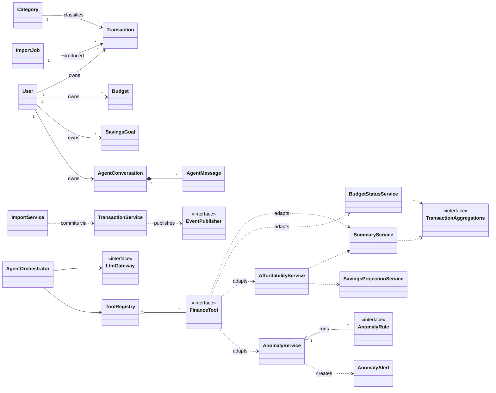

---

## 2. common

Shared kernel: value objects, base classes, eventing ports, and the error model.

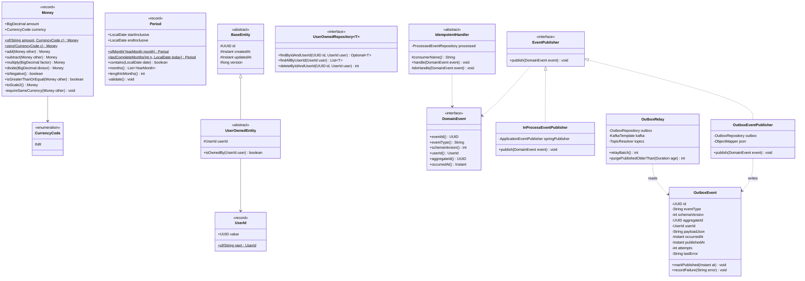

**Notes**

- `EventPublisher` is chosen by `meb.events.mode`. `in-process` hands events to Spring's `@TransactionalEventListener(AFTER_COMMIT)` handlers. `kafka` writes the `OutboxEvent` inside the caller's DB transaction.
- `IdempotentHandler.handle()` is a template method. It does `INSERT INTO processed_events (consumer, event_id) … ON CONFLICT DO NOTHING` and calls `doHandle()` only when that insert added a row, all in one transaction. Every event handler extends it, whether it runs in-process or as a Kafka consumer.
- **Event contracts.** Each event (`TransactionCreated`, `BudgetThresholdReached`, `AnomalyDetected`, …) is a record implementing `DomainEvent`. It lives in the **publishing module's public `events` package**, for example `transactions.events` or `analytics.events`, which is a named interface in Spring Modulith terms. A module that consumes an event may depend on the publisher's `events` package and on nothing else in that module.
- `UserOwnedRepository` hides `findById` and `findAll`. Module repositories extend it **instead of** `JpaRepository` directly.

---

## 3. identity

```mermaid
classDiagram
    direction TB

    class User {
        -UUID id
        -String email
        -String passwordHash
        -String displayName
        -boolean demo
        +changePassword(String newHash) void
        +isDemo() boolean
    }

    class UserSettings {
        -UserId userId
        -CurrencyCode baseCurrency
        -ZoneId timezone
        -Money currentSavings
        -Instant currentSavingsUpdatedAt
        -int emergencyBufferMonths
        -Money largeTxnThreshold
        -BigDecimal anomalyMultiplier
        -int categorySpikePct
        +updateCurrentSavings(Money amount, Instant at) void
        +today(Clock clock) LocalDate
        +currentMonth(Clock clock) YearMonth
    }

    class RefreshToken {
        -UUID id
        -UserId userId
        -String tokenHash
        -UUID familyId
        -Instant expiresAt
        -Instant revokedAt
        -UUID replacedBy
        +isActive(Instant now) boolean
        +rotate(RefreshToken next, Instant now) void
        +revoke(Instant now) void
    }

    class CurrentUser {
        <<record>>
        +UserId id
    }

    class AuthService {
        -UserRepository users
        -PasswordEncoder encoder
        -JwtService jwt
        -RefreshTokenService refreshTokens
        -UserSettingsService settings
        +register(RegisterCommand cmd) AuthTokens
        +login(LoginCommand cmd) AuthTokens
        +demoLogin() AuthTokens
        +refresh(String rawRefreshToken) AuthTokens
        +logout(String rawRefreshToken) void
    }

    class JwtService {
        -SecretKey key
        -Duration accessTtl
        -Clock clock
        +issueAccessToken(UserId user) String
        +parse(String token) CurrentUser
    }

    class RefreshTokenService {
        -RefreshTokenRepository repo
        -Clock clock
        +issue(UserId user) IssuedRefreshToken
        +rotate(String raw) RotationResult
        +revokeFamily(UUID familyId) void
        -hash(String raw) String
    }

    class UserSettingsService {
        -UserSettingsRepository repo
        -CacheGenerationService cacheGen
        +get(UserId user) UserSettings
        +update(UserId user, UpdateSettingsCommand cmd) UserSettings
        +createDefaults(UserId user) UserSettings
    }

    class JwtAuthenticationFilter {
        -JwtService jwt
        #doFilterInternal(request, response, chain) void
    }

    class CurrentUserArgumentResolver {
        +resolveArgument(...) CurrentUser
    }

    class AuthTokens {
        <<record>>
        +String accessToken
        +long expiresInSeconds
        +String refreshToken
    }

    User "1" *-- "1" UserSettings
    User "1" --> "*" RefreshToken
    AuthService --> JwtService
    AuthService --> RefreshTokenService
    AuthService --> UserSettingsService
    AuthService ..> AuthTokens : returns
    JwtAuthenticationFilter --> JwtService
    JwtAuthenticationFilter ..> CurrentUser : sets principal
    CurrentUserArgumentResolver ..> CurrentUser
```

**Rotation logic in `RefreshTokenService.rotate(raw)`:**

1. Hash the raw token and find it.
2. If it is unknown or expired, throw `UnauthorizedException`.
3. If it is already revoked, the token is being **reused**. Call `revokeFamily(familyId)` and throw `UnauthorizedException("token_reused")`.
4. Otherwise issue a new token with the same `familyId` and call `old.rotate(new, now)`.

---

## 4. transactions + import

### 4.1 Transactions and categories

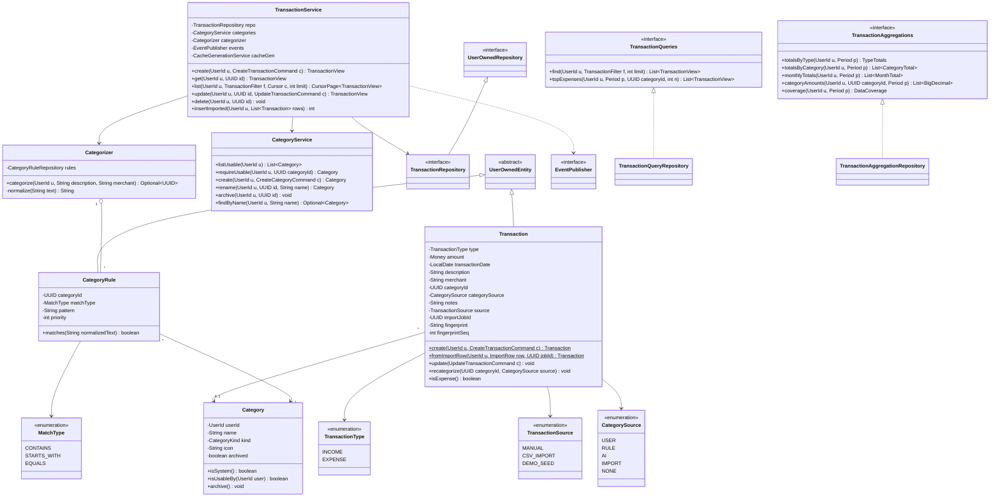

`Category.userId` is null for system categories. `Transaction.categoryId`, `importJobId` and `fingerprint` are nullable.

`TransactionAggregationRepository` implements every aggregate as one native SQL statement (`GROUP BY`, `date_trunc('month', …)`). This is the **only** class that issues aggregate SQL over `transactions`, and the analytics and budgets modules depend on the interface, not on this class.

### 4.2 CSV import

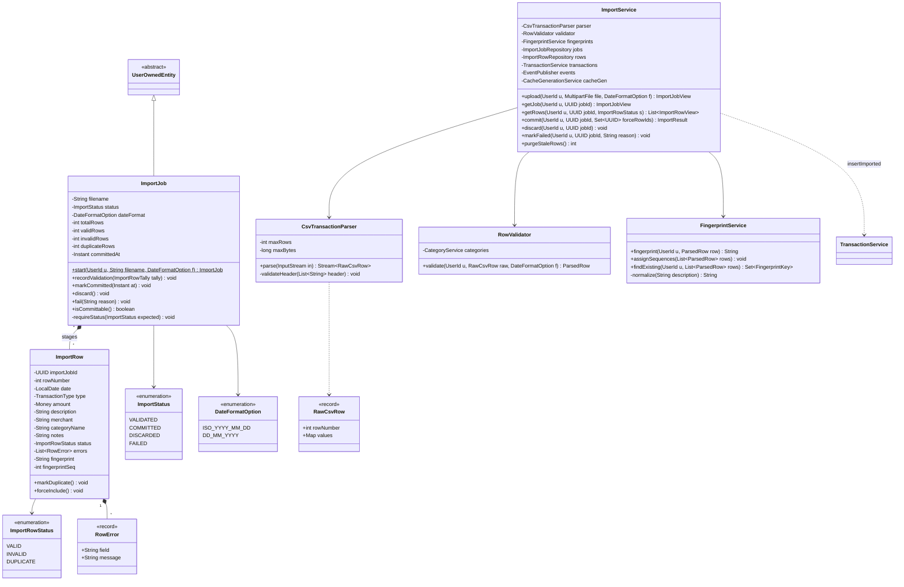

`RawCsvRow.values` is a `Map<String, String>` of header to cell value.

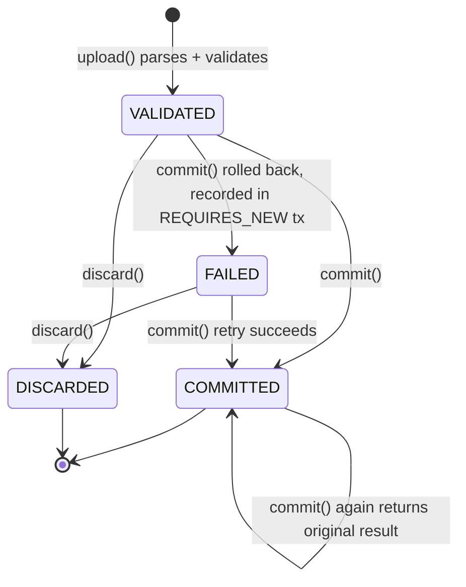

**`ImportService.commit()` steps.** All of these run in one `@Transactional` boundary.

**`FAILED` is recorded separately.** If the commit transaction rolls back, everything inside it is undone, including any status change. The controller therefore calls `ImportService.markFailed(jobId, reason)`, which runs in a separate `REQUIRES_NEW` transaction and records `FAILED`. Calling `commit()` on a `FAILED` job retries the commit.

1. Load the job and require status `VALIDATED` or `FAILED`. If the job is already `COMMITTED`, return the stored `ImportResult` instead.
2. Load the rows that are `VALID`, plus the `DUPLICATE` rows listed in `forceRowIds`. A forced row gets `fingerprint = null`.
3. Convert each row with `Transaction.fromImportRow(…)`, then write them with `transactions.insertImported(...)` in batches of 500.
4. Call `job.markCommitted(now)` and `events.publish(new TransactionsImported(...))`.
5. After commit, call `cacheGen.bump(userId)`.

---

## 5. budgets

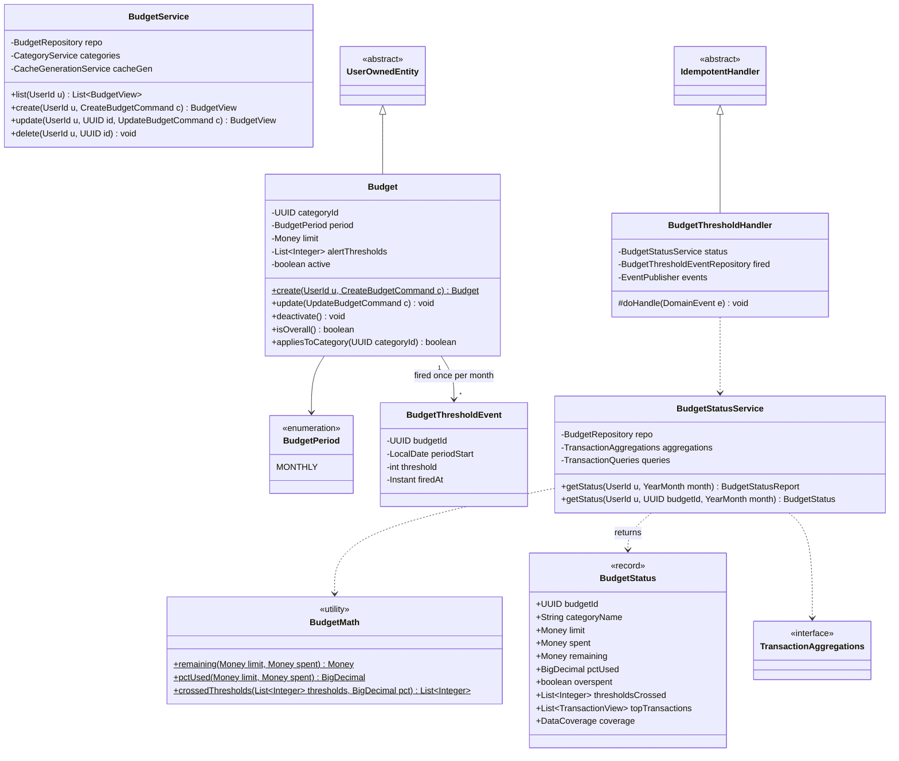

`Budget.categoryId` is null for the overall budget.

`BudgetThresholdHandler` listens for `TransactionCreated`, `TransactionUpdated`, `TransactionDeleted` and `TransactionsImported`. For each crossed threshold it runs `INSERT … ON CONFLICT DO NOTHING` into `budget_threshold_events`. It publishes `BudgetThresholdReached` only when that insert added a row, so each threshold fires at most once per month.

---

## 6. goals

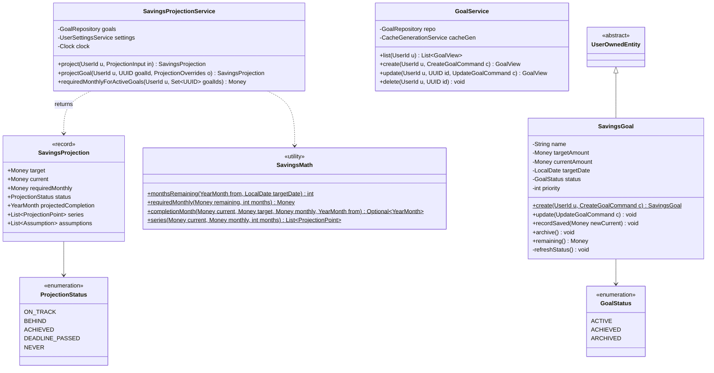

`ProjectionInput` carries `targetAmount`, `targetDate`, `currentSavings` (optional) and `monthlyContribution` (optional), and never a user ID. When `monthlyContribution` is absent, the service returns the *required* contribution and uses it for the series. Every projection includes the assumptions `"0% return"` and `"constant monthly contribution"`, both labelled `DEFAULT_ASSUMPTION`.

---

## 7. analytics + anomaly

### 7.1 Summaries, comparisons, affordability

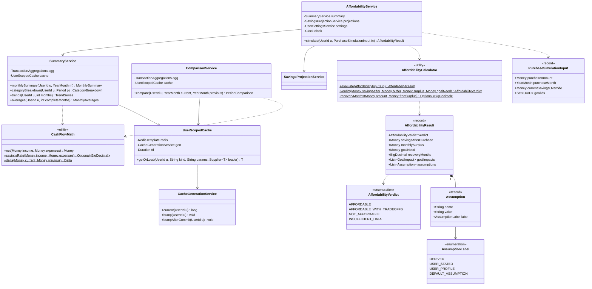

**Nullable inputs.** In `PurchaseSimulationInput`, `purchaseMonth`, `currentSavingsOverride` and `goalIds` are nullable:

| Field | When null |
|---|---|
| `purchaseMonth` | The current month in the user's timezone |
| `currentSavingsOverride` | `UserSettings.currentSavings` is used and labelled `USER_PROFILE` |
| `goalIds` | All active goals are used |

`AffordabilityResult.recoveryMonths` is null when it can never be reached.

**`UserScopedCache.getOrLoad`:**

1. Read `gen = current(u)`. This happens *before* the loader runs; see architecture §11.1 for why.
2. Build the key `meb:{env}:u:{u}:g{gen}:{kind}:{params}`.
3. Look the key up. On a miss, call `loader.get()`, then `SET` with the TTL plus jitter.
4. If Redis throws, call the loader directly.

When `meb.cache.enabled=false`, a `NoOpUserScopedCache` subclass always calls the loader.

### 7.2 Anomaly rules (Strategy)

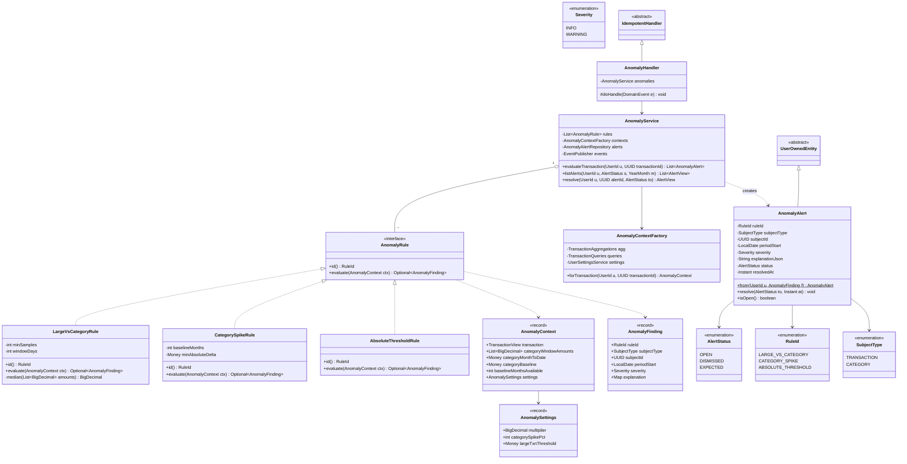

**Supporting notes**

- `AnomalySettings` is a read-only view that `AnomalyContextFactory` builds from `UserSettingsService`. Rules never see the identity module's `UserSettings` entity, which keeps them inside the module boundary.
- `AnomalyFinding.explanation` is a `Map<String, Object>` that becomes `explanation jsonb` when stored. Each rule has its own explanation keys; architecture §9.5 lists them.
- `AnomalyService.evaluateTransaction` runs every rule. It inserts alerts with `ON CONFLICT DO NOTHING`, using the unique `(user, rule, subject, period)`. It publishes `AnomalyDetected` only for alerts that were actually new.
- **Adding a rule** means writing a new `@Component` that implements `AnomalyRule`. Spring injects every implementation into `List<AnomalyRule>`, so no other code changes.

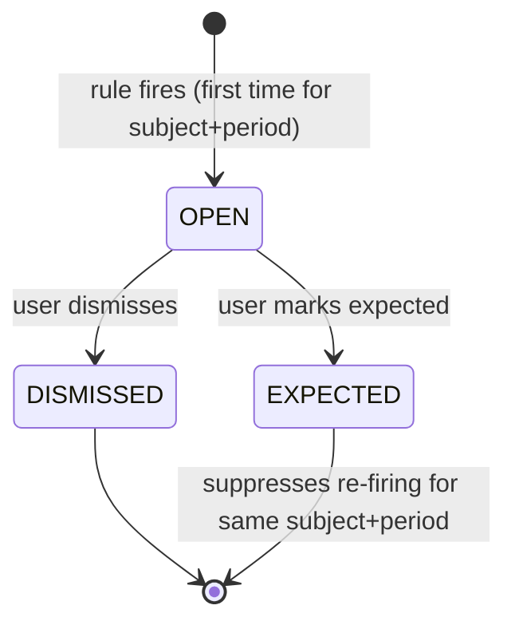

---

## 8. agent

### 8.1 Orchestration

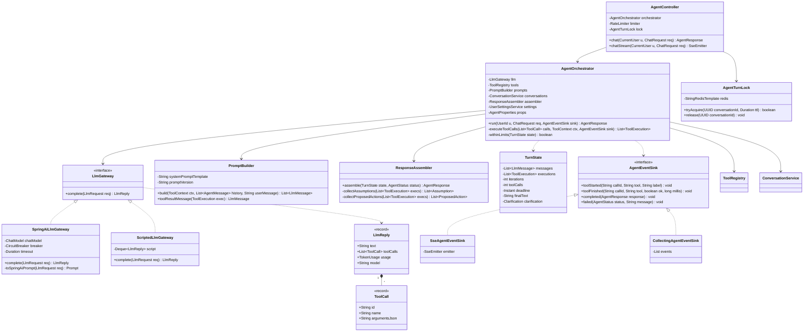

**Implementations.** `SpringAiLlmGateway` is the only class that imports Spring AI types; it runs with Spring AI's internal tool execution disabled. `ScriptedLlmGateway` is used in tests and in the offline demo profile.

**`AgentOrchestrator.run` steps:**

1. Load settings and build `ToolContext(userId, tz, currency, today)`.
2. Load the conversation, or create one, and append the user message.
3. Repeat while `withinLimits` (≤ 5 iterations, ≤ 8 tool calls, before the deadline):
   1. Send the messages plus the tool definitions to `llm.complete(...)`.
   2. If the reply contains no tool calls, record it as `finalText` and stop.
   3. If one of the tool calls is `askClarifyingQuestion`, store the clarification and stop.
   4. Otherwise run `executeToolCalls(...)` and append each result to the messages.
4. Call `assembler.assemble(state, status)`.
5. Persist the assistant message with `tool_metadata` set to the evidence.
6. Call `sink.completed(response)`.

### 8.2 Tools (Strategy + Adapter + Registry)

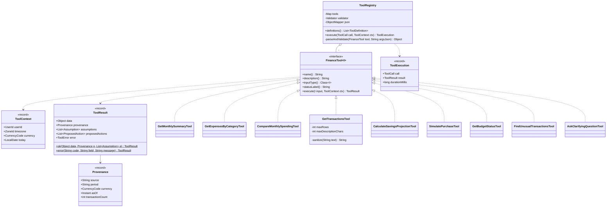

**`ToolRegistry` internals.** `tools` is a `Map<String, FinanceTool<?>>` built from every `FinanceTool` bean, which makes it the allow-list.

`execute()` turns any failure into a `ToolResult.error(...)` that goes back to the model; it never throws. The cases are:

| Failure | Error code |
|---|---|
| Unknown tool name | `UNKNOWN_TOOL` |
| JSON parse failure | `INVALID_ARGUMENT` |
| Bean Validation violation | `INVALID_ARGUMENT` with the offending field |
| `NotFoundException` from a service | `NOT_FOUND` |

Each result's serialised size is capped at about 8 KB.

**Tool inputs.** These are Java records with Bean Validation annotations. Spring AI uses them to generate each tool's JSON schema. **None of them has a `userId` field.**

| Tool | Input record (fields) | Calls | Output `data` type |
|---|---|---|---|
| `getMonthlySummary` | `MonthInput(@Pattern YYYY-MM month)` | `SummaryService.monthlySummary` | `MonthlySummary` |
| `getExpensesByCategory` | `DateRangeInput(LocalDate startDate, LocalDate endDate)` ≤ 24 mo | `SummaryService.categoryBreakdown` | `CategoryBreakdown` |
| `compareMonthlySpending` | `CompareInput(currentMonth, previousMonth)` | `ComparisonService.compare` | `PeriodComparison` |
| `getTransactions` | `TransactionSearchInput(from, to, category, type, text, minAmount, @Max(50) limit)` | `TransactionQueries.find` | `List<ToolTransactionRow>` (truncated text) |
| `calculateSavingsProjection` | `ProjectionToolInput(goalId \| targetAmount+targetDate, currentSavings, monthlyContribution)` | `SavingsProjectionService.project / projectGoal` | `SavingsProjection` |
| `simulatePurchase` | `PurchaseToolInput(@Positive purchaseAmount, purchaseMonth, currentSavingsOverride, goalIds)` | `AffordabilityService.simulate` | `AffordabilityResult` |
| `getBudgetStatus` | `MonthInput(month)` | `BudgetStatusService.getStatus` | `BudgetStatusReport` |
| `findUnusualTransactions` | `MonthInput(month)` | `AnomalyService.listAlerts(OPEN, month)` | `List<AlertView>` |
| `askClarifyingQuestion` | `ClarifyInput(@NotBlank question, List<String> options)` | — (pseudo-tool, ends turn) | `Clarification` |

Every tool except the pseudo-tool calls the **same service method** as the matching REST endpoint. This mapping is what guarantees the dashboard and the copilot never disagree.

### 8.3 Conversations and response

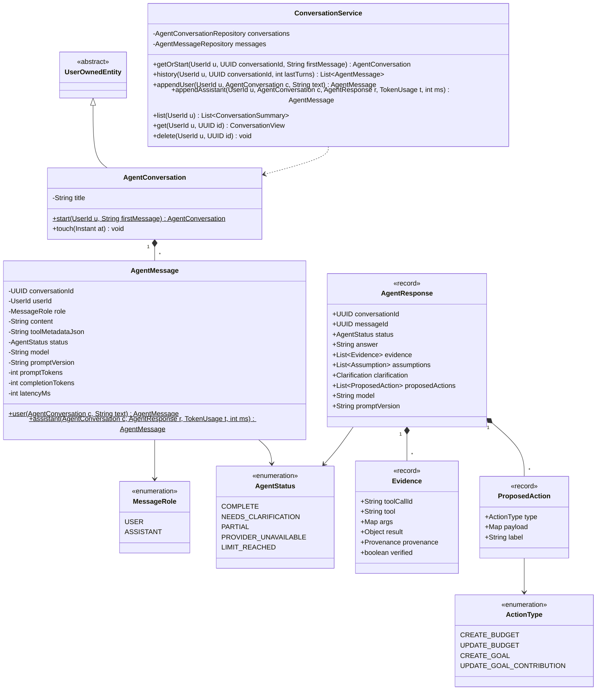

`ProposedAction`s are **never executed by the backend agent**. The UI shows each one as a button that opens a pre-filled form, and saving that form calls the normal REST endpoint (`POST /budgets`, …).

---

## 9. notifications + infrastructure

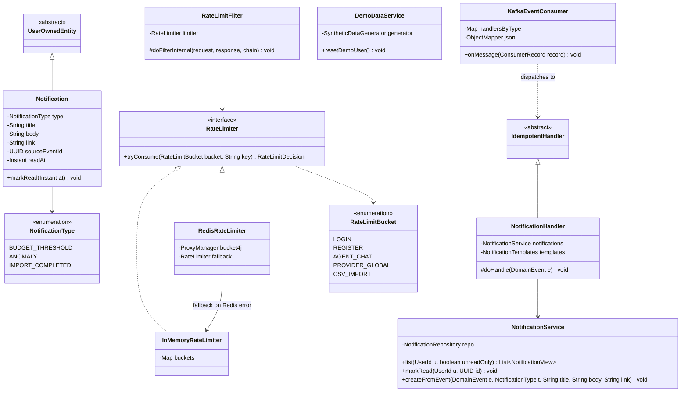

`Notification.sourceEventId` is unique, so a replayed event cannot create a second notification.

`KafkaEventConsumer` is active only when `events.mode=kafka`. It deserialises the envelope and dispatches to the same `IdempotentHandler` beans that the in-process mode calls directly. Its `handlersByType` is a `Map<String, List<IdempotentHandler>>`.

---

## 10. Service catalogue

`@Tx` means `@Transactional`; `RO` means `readOnly = true`. "Callers" lists where the service is called from: REST, the agent's tools, and the event handlers.

### 10.1 Domain services

| Service | Module | Responsibility | Key methods | Callers | Tx | Events published |
|---|---|---|---|---|---|---|
| **AuthService** | identity | Register, login, demo login, token refresh, logout | `register`, `login`, `demoLogin`, `refresh`, `logout` | REST `/auth/*` | @Tx | — |
| **JwtService** | identity | Issue and verify access JWTs | `issueAccessToken`, `parse` | AuthService, JwtAuthenticationFilter | — | — |
| **RefreshTokenService** | identity | Issue, rotate, revoke-family, reuse detection | `issue`, `rotate`, `revokeFamily` | AuthService | @Tx | — |
| **UserSettingsService** | identity | Timezone, currency, current savings, anomaly thresholds | `get`, `update`, `createDefaults` | REST `/me/settings`; Affordability, Projection, Anomaly, Agent | @Tx | — (bumps cache gen) |
| **CategoryService** | transactions | System + custom categories; ownership checks | `listUsable`, `requireUsable`, `create`, `rename`, `archive`, `findByName` | REST `/categories`; TransactionService, RowValidator, BudgetService | @Tx | — |
| **Categorizer** | transactions | Apply `category_rules` by priority | `categorize` | TransactionService, ImportService | RO | — |
| **TransactionService** | transactions | Transaction CRUD, keyset listing, bulk insert for import | `create`, `get`, `list`, `update`, `delete`, `insertImported` | REST `/transactions`; ImportService | @Tx | `TransactionCreated/Updated/Deleted` |
| **TransactionQueries** | transactions | Filtered reads, top-N per category | `find`, `topExpenses` | Tool `getTransactions`; BudgetStatus, AnomalyContextFactory | RO | — |
| **TransactionAggregations** | transactions | All SQL aggregates over transactions | `totalsByType`, `totalsByCategory`, `monthlyTotals`, `categoryAmounts`, `coverage` | Summary, Comparison, BudgetStatus, AnomalyContextFactory | RO | — |
| **ImportService** | transactions | CSV upload → validate → stage → commit / discard; purge | `upload`, `getJob`, `getRows`, `commit`, `discard`, `purgeStaleRows` | REST `/imports`; scheduler | @Tx (commit atomic) | `TransactionsImported` |
| **FingerprintService** | transactions | Duplicate fingerprint + per-file sequence | `fingerprint`, `assignSequences`, `findExisting` | ImportService | RO | — |
| **BudgetService** | budgets | Budget CRUD | `list`, `create`, `update`, `delete` | REST `/budgets` | @Tx | — (bumps cache gen) |
| **BudgetStatusService** | budgets | Spent / remaining / % / thresholds / evidence txns | `getStatus(u, month)`, `getStatus(u, budgetId, month)` | REST `/budgets/status`; Tool `getBudgetStatus`; BudgetThresholdHandler | RO | — |
| **GoalService** | goals | Savings goal CRUD | `list`, `create`, `update`, `delete` | REST `/goals` | @Tx | — (bumps cache gen) |
| **SavingsProjectionService** | goals | Required contribution, completion month, series, what-if | `project`, `projectGoal`, `requiredMonthlyForActiveGoals` | REST `/goals/*/projection`; Tool `calculateSavingsProjection`; AffordabilityService | RO | — |
| **SummaryService** | analytics | Monthly summary, category breakdown, trends, averages | `monthlySummary`, `categoryBreakdown`, `trends`, `averages` | REST `/analytics/*`; Tools `getMonthlySummary`, `getExpensesByCategory`; AffordabilityService | RO (cached) | — |
| **ComparisonService** | analytics | Month-over-month by category | `compare` | REST `/analytics/compare`; Tool `compareMonthlySpending` | RO (cached) | — |
| **AffordabilityService** | analytics | Purchase simulation with labelled assumptions | `simulate` | REST `/simulations/purchase`; Tool `simulatePurchase` | RO | — |
| **AnomalyService** | analytics | Run rules, store alerts, list / resolve alerts | `evaluateTransaction`, `listAlerts`, `resolve` | REST `/alerts`; Tool `findUnusualTransactions`; AnomalyHandler | @Tx | `AnomalyDetected` |
| **ConversationService** | agent | Conversation + message persistence, history window | `getOrStart`, `history`, `appendUser`, `appendAssistant`, `list`, `get`, `delete` | AgentOrchestrator; REST `/agent/conversations` | @Tx | — |
| **AgentOrchestrator** | agent | Tool loop, limits, timeouts, response assembly | `run` | AgentController | per-step (no long Tx across LLM calls) | — |
| **NotificationService** | notifications | In-app notifications | `list`, `markRead`, `createFromEvent` | REST `/notifications`; NotificationHandler | @Tx | — |

### 10.2 Event handlers (all extend `IdempotentHandler`)

| Handler | Consumer name | Listens to | Does |
|---|---|---|---|
| `AnomalyHandler` | `meb-analytics.anomaly` | `TransactionCreated`, `TransactionUpdated`, `TransactionsImported` | `AnomalyService.evaluateTransaction` for each affected expense |
| `BudgetThresholdHandler` | `meb-analytics.budget` | `TransactionCreated`, `TransactionUpdated`, `TransactionDeleted`, `TransactionsImported` | Re-check affected month → `BudgetThresholdReached` once per threshold |
| `NotificationHandler` | `meb-notifications` | `BudgetThresholdReached`, `AnomalyDetected`, `TransactionsImported` | Create notification (unique on `sourceEventId`) |

### 10.3 Infrastructure services

| Component | Responsibility | Implementations |
|---|---|---|
| `EventPublisher` | Publish domain events after commit | `InProcessEventPublisher`, `OutboxEventPublisher` |
| `OutboxRelay` | Poll outbox → Kafka, mark published, purge | `@Scheduled` (500 ms) |
| `KafkaEventConsumer` | Deserialize envelope → dispatch to handlers | Spring Kafka listener + `DefaultErrorHandler` + DLT |
| `UserScopedCache` / `CacheGenerationService` | Generation-keyed cache-aside | Redis / `NoOpUserScopedCache` |
| `RateLimiter` | Token-bucket limits per bucket | `RedisRateLimiter` (Bucket4j), `InMemoryRateLimiter` |
| `AgentTurnLock` | One in-flight turn per conversation | Redis `SET NX EX`; in-memory when Redis is off |
| `LlmGateway` | Model calls, timeout, retry, circuit breaker | `SpringAiLlmGateway`, `ScriptedLlmGateway` |
| `DemoDataService` | Seed / nightly reset of demo user | `@Scheduled` cron |
| `GlobalExceptionHandler` | Map exceptions → RFC 9457 ProblemDetail | `@RestControllerAdvice` |

### 10.4 Controllers → services

| Controller | Base path | Services |
|---|---|---|
| `AuthController` | `/auth` | AuthService |
| `MeController` | `/me` | UserSettingsService |
| `CategoryController`, `CategoryRuleController` | `/categories`, `/category-rules` | CategoryService |
| `TransactionController` | `/transactions` | TransactionService |
| `ImportController` | `/imports` | ImportService |
| `AnalyticsController` | `/analytics` | SummaryService, ComparisonService |
| `BudgetController` | `/budgets` | BudgetService, BudgetStatusService |
| `GoalController` | `/goals` | GoalService, SavingsProjectionService |
| `SimulationController` | `/simulations` | AffordabilityService |
| `AlertController` | `/alerts` | AnomalyService |
| `NotificationController` | `/notifications` | NotificationService |
| `AgentController` | `/agent` | AgentOrchestrator, ConversationService |

---

## 11. Enums, commands and DTOs

### 11.1 Enums

| Enum | Values | Module |
|---|---|---|
| `CurrencyCode` | `INR` | common |
| `TransactionType` | `INCOME`, `EXPENSE` | transactions |
| `TransactionSource` | `MANUAL`, `CSV_IMPORT`, `DEMO_SEED` | transactions |
| `CategorySource` | `USER`, `RULE`, `AI`, `IMPORT`, `NONE` | transactions |
| `CategoryKind` | `EXPENSE`, `INCOME` | transactions |
| `MatchType` | `CONTAINS`, `STARTS_WITH`, `EQUALS` | transactions |
| `ImportStatus` | `VALIDATED`, `COMMITTED`, `DISCARDED`, `FAILED` | transactions |
| `ImportRowStatus` | `VALID`, `INVALID`, `DUPLICATE` | transactions |
| `DateFormatOption` | `ISO_YYYY_MM_DD`, `DD_MM_YYYY` | transactions |
| `BudgetPeriod` | `MONTHLY` | budgets |
| `GoalStatus` | `ACTIVE`, `ACHIEVED`, `ARCHIVED` | goals |
| `ProjectionStatus` | `ON_TRACK`, `BEHIND`, `ACHIEVED`, `DEADLINE_PASSED`, `NEVER` | goals |
| `AffordabilityVerdict` | `AFFORDABLE`, `AFFORDABLE_WITH_TRADEOFFS`, `NOT_AFFORDABLE`, `INSUFFICIENT_DATA` | analytics |
| `AssumptionLabel` | `DERIVED`, `USER_STATED`, `USER_PROFILE`, `DEFAULT_ASSUMPTION` | analytics |
| `RuleId` | `LARGE_VS_CATEGORY`, `CATEGORY_SPIKE`, `ABSOLUTE_THRESHOLD` | analytics |
| `AlertStatus` | `OPEN`, `DISMISSED`, `EXPECTED` | analytics |
| `SubjectType` | `TRANSACTION`, `CATEGORY` | analytics |
| `Severity` | `INFO`, `WARNING` | analytics |
| `MessageRole` | `USER`, `ASSISTANT` | agent |
| `AgentStatus` | `COMPLETE`, `NEEDS_CLARIFICATION`, `PARTIAL`, `PROVIDER_UNAVAILABLE`, `LIMIT_REACHED` | agent |
| `ActionType` | `CREATE_BUDGET`, `UPDATE_BUDGET`, `CREATE_GOAL`, `UPDATE_GOAL_CONTRIBUTION` | agent |
| `NotificationType` | `BUDGET_THRESHOLD`, `ANOMALY`, `IMPORT_COMPLETED` | notifications |
| `RateLimitBucket` | `LOGIN`, `REGISTER`, `AGENT_CHAT`, `PROVIDER_GLOBAL`, `CSV_IMPORT` | infra |

### 11.2 Commands (REST input; none contain `userId`)

| Record | Fields (validation) |
|---|---|
| `RegisterCommand` | `@Email email`, `@Size(min=10) password`, `@NotBlank displayName` |
| `LoginCommand` | `email`, `password` |
| `UpdateSettingsCommand` | `timezone`, `currentSavings`, `emergencyBufferMonths (0–24)`, `largeTxnThreshold`, `anomalyMultiplier (1.5–10)`, `categorySpikePct (10–500)` — all optional |
| `CreateTransactionCommand` | `@NotNull type`, `@NotNull @PositiveMoney amount (MoneyDto)`, `@PastOrPresent transactionDate`, `@NotBlank @Size(max=255) description`, `merchant`, `categoryId`, `@Size(max=1000) notes` |
| `UpdateTransactionCommand` | same as create + `@NotNull Long version` |
| `TransactionFilter` | `from`, `to`, `categoryId`, `type`, `q` (text), `minAmount`, `maxAmount` |
| `CreateCategoryCommand` | `@NotBlank name`, `kind`, `icon` |
| `CreateBudgetCommand` / `UpdateBudgetCommand` | `categoryId` (null = overall), `@Positive limit`, `alertThresholds` (1–200, ≤ 5 values), `version` on update |
| `CreateGoalCommand` / `UpdateGoalCommand` | `@NotBlank name`, `@Positive targetAmount`, `@PositiveOrZero currentAmount`, `@Future targetDate`, `priority`, `version` on update |
| `ProjectionInput` / `ProjectionOverrides` | `targetAmount`, `targetDate`, `currentSavings`, `monthlyContribution` |
| `PurchaseSimulationInput` | `@Positive purchaseAmount`, `purchaseMonth`, `currentSavingsOverride`, `goalIds` |
| `ChatRequest` | `conversationId` (optional), `@NotBlank @Size(max=2000) message` |
| `ResolveAlertCommand` | `@NotNull status` ∈ {`DISMISSED`, `EXPECTED`} |

### 11.3 Views / results (REST + tool output)

| Record | Key fields |
|---|---|
| `MoneyDto` | `String amount`, `CurrencyCode currency` (wire format). Because `amount` is a string, the built-in `@Positive` constraint cannot apply to it. A custom `@PositiveMoney` constraint parses the string as a `BigDecimal` and checks that the value is greater than 0 and has scale ≤ 2. |
| `TransactionView` | `id, type, amount, transactionDate, description, merchant, category{id,name}, categorySource, notes, source, version` |
| `CursorPage<T>` | `items`, `nextCursor` |
| `ImportJobView` | `id, status, totals{total,valid,invalid,duplicate}, sampleErrors[]` |
| `ImportResult` | `jobId, imported, skippedDuplicates, skippedInvalid` |
| `MonthlySummary` | `month, income, expenses, net, savingsRate (nullable), savingsRateReason, coverage` |
| `CategoryBreakdown` | `period, total, categories[{categoryId, name, amount, pct, count}], coverage` |
| `TrendSeries` | `points[{month, income, expenses, net}]` |
| `PeriodComparison` | `current, previous, totals{current, previous, delta, deltaPct}, categories[{name, current, previous, delta, deltaPct, isNew}]` |
| `DataCoverage` | `transactionCount, firstDate, lastDate, completeMonths` |
| `BudgetStatusReport` | `month, budgets[BudgetStatus]` |
| `SavingsProjection` | see §6 |
| `AffordabilityResult` | see §7.1 |
| `AlertView` | `id, ruleId, subject, periodStart, severity, explanation, status, createdAt` |
| `AgentResponse` | see §8.3 |

---

## 12. Design patterns, exceptions, flows

### 12.1 Design patterns

| Pattern | Where | Why |
|---|---|---|
| **Strategy** | `AnomalyRule` (3 rules), `EventPublisher` (in-process / outbox), `RateLimiter` (Redis / in-memory), `LlmGateway` (Spring AI / scripted), `AgentEventSink` (SSE / collecting), `FinanceTool` (9 tools) | Swap behaviour by config or add a variant without touching callers |
| **Registry** | `ToolRegistry` | Explicit allow-list of what the model may call |
| **Adapter** | Each `FinanceTool` wraps a domain service; `SpringAiLlmGateway` wraps Spring AI `ChatModel` | Keeps domain services and the model provider unaware of each other |
| **Facade** | `AgentOrchestrator` | One entry point hiding prompt, LLM, tools, persistence |
| **Template Method** | `IdempotentHandler.handle()` → `doHandle()` | Idempotency logic written once for all consumers |
| **Repository** | `UserOwnedRepository<T>` and module repositories | User-scoped data access as the only access path |
| **Value Object** | `Money`, `Period`, `UserId`, `Assumption`, `Provenance` | Immutability, validation and arithmetic in one place |
| **Transactional Outbox** | `OutboxEventPublisher` + `OutboxRelay` | Reliable DB → Kafka without dual writes |
| **Observer / Pub-Sub** | Domain events → handlers (in-process or Kafka) | Decouple writes from anomaly, budget and notification work |
| **Factory method** | `Transaction.create / fromImportRow`, `AnomalyAlert.from`, `AgentMessage.user / assistant`, `ToolResult.ok / error` | Valid construction only |
| **State (guarded transitions)** | `ImportJob`, `AnomalyAlert`, `RefreshToken`, `SavingsGoal` | Illegal transitions rejected inside the entity |
| **Null Object** | `NoOpUserScopedCache` | Cache disabled = no `if` branches in services |
| **Circuit Breaker** | Resilience4j inside `SpringAiLlmGateway` | Fail fast when provider is down |

### 12.2 Exception hierarchy → HTTP / ProblemDetail

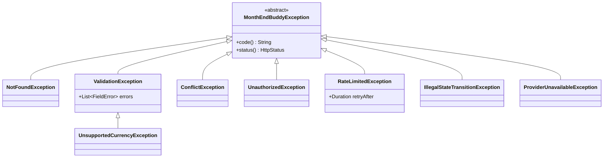

| Exception | HTTP | `code` | Typical source |
|---|---|---|---|
| `NotFoundException` | 404 | `not_found` | `findByIdAndUserId` empty — also for other users' IDs |
| `ValidationException` | 422 | `validation_failed` | Bean Validation, CSV header, range > 24 months |
| `UnsupportedCurrencyException` | 422 | `unsupported_currency` | Non-base currency |
| `ConflictException` | 409 | `version_conflict` / `turn_in_progress` | Optimistic lock, `AgentTurnLock` |
| `IllegalStateTransitionException` | 409 | `invalid_state` | `ImportJob.discard()` after commit |
| `UnauthorizedException` | 401 | `invalid_credentials` / `token_expired` / `token_reused` | Auth |
| `RateLimitedException` | 429 | `rate_limited` + `Retry-After` | `RateLimitFilter` |
| `ProviderUnavailableException` | — (turned into `AgentResponse.status = PROVIDER_UNAVAILABLE`, HTTP 200) | `provider_unavailable` | `SpringAiLlmGateway` |

### 12.3 Flows (in architecture.md)

- Login and token refresh: [architecture §5.2](architecture.md#52-tokens)
- CSV import upload → commit: [architecture §8.4](architecture.md#84-import-flow)
- Agent turn with tool calls: [architecture §10.3](architecture.md#103-orchestration-loop)
- Transaction write → outbox → Kafka → handlers: [architecture §12.2](architecture.md#122-outbox-and-relay)

### 12.4 Package layout (backend)

```text
dev.monthendbuddy
├── common/        Money, Period, UserId, BaseEntity, UserOwnedEntity, UserOwnedRepository,
│                  DomainEvent, EventPublisher (+impls), OutboxEvent, OutboxRelay, IdempotentHandler,
│                  exceptions/, web/GlobalExceptionHandler, cache/, ratelimit/
├── identity/      api/ AuthController, MeController · application/ AuthService, JwtService,
│                  RefreshTokenService, UserSettingsService · domain/ User, UserSettings, RefreshToken
│                  · infrastructure/ JwtAuthenticationFilter, CurrentUserArgumentResolver, repositories
├── transactions/  api/ · application/ TransactionService, CategoryService, Categorizer, ImportService
│                  · domain/ Transaction, Category, CategoryRule, ImportJob, ImportRow, events/
│                  · infrastructure/ CsvTransactionParser, RowValidator, FingerprintService,
│                    TransactionQueryRepository, TransactionAggregationRepository
├── budgets/       api/ · application/ BudgetService, BudgetStatusService, BudgetThresholdHandler
│                  · domain/ Budget, BudgetThresholdEvent, BudgetMath
├── goals/         api/ · application/ GoalService, SavingsProjectionService · domain/ SavingsGoal, SavingsMath
├── analytics/     api/ · application/ SummaryService, ComparisonService, AffordabilityService, AnomalyService,
│                  AnomalyHandler · domain/ CashFlowMath, AffordabilityCalculator, anomaly/ (rules, AnomalyAlert)
├── agent/         api/ AgentController · application/ AgentOrchestrator, ConversationService, PromptBuilder,
│                  ResponseAssembler · tools/ FinanceTool, ToolRegistry, 9 tools · infrastructure/
│                  SpringAiLlmGateway, ScriptedLlmGateway, AgentTurnLock, SseAgentEventSink
└── notifications/ api/ · application/ NotificationService, NotificationHandler · domain/ Notification
```
